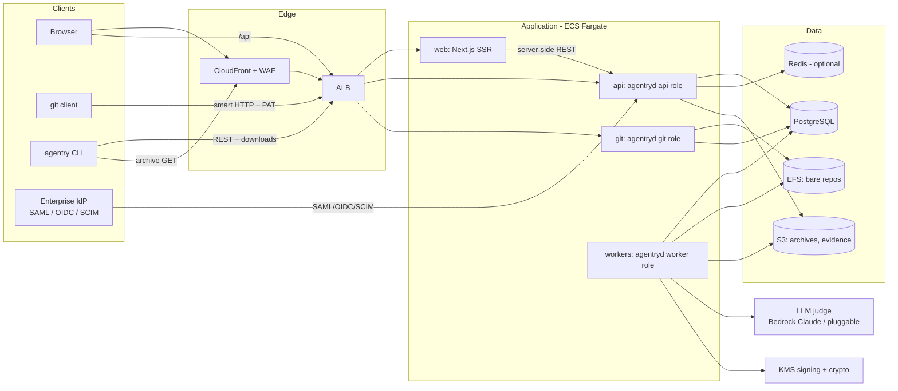
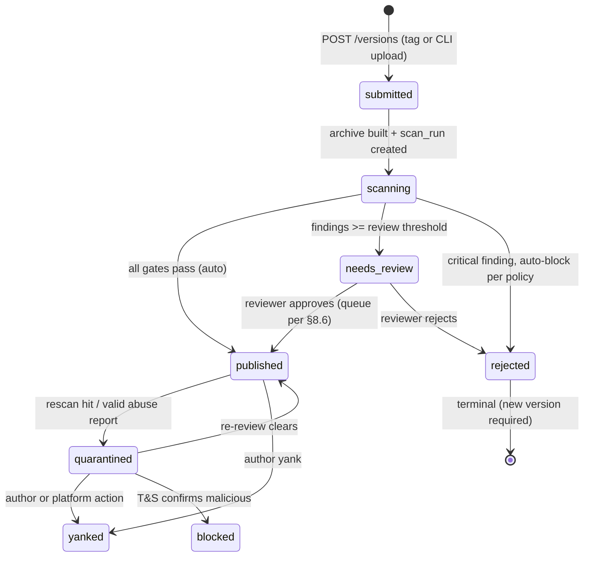
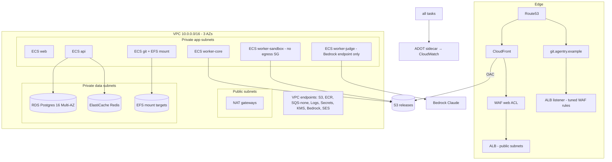

# Agentry — Build Plan

**A multi-layer web platform, hosted on AWS, that is "GitHub for single-purpose AI agents": git-backed hosting, an agent registry with immutable versioned releases, and a mandatory pre-publication security pipeline (prompt-injection scanning, capability analysis, provenance signing). The framework is open source; the hosted website is a product built on the framework.**

| Field | Value |
|---|---|
| Document status | Draft for human review — see §20 Open Questions before building |
| Date | 2026-08-27 |
| Phase covered | v1.0 (private beta → public launch), with explicit v2 deferrals |
| Working codename | **Agentry** (framework/OSS), **Agentry Cloud** (hosted product). ALL names are placeholders — see Q1. |
| Audience | (a) the human reviewing/approving this plan; (b) the builder agent implementing it |

---

## §0 How to use this document (instructions to the builder agent)

This document is the **single source of truth** for building v1. It was written so you do not need the research context that produced it.

**Contract:**

1. **Do not re-research settled decisions.** §21 (Decision Log) lists every settled decision with rationale. If you disagree with one, record your objection in `DEVIATIONS.md` and proceed as specified — unless it is impossible or insecure, in which case stop and ask the human.
2. **Do not build anything gated on §20.** Open Questions (Q1–Q10) must be answered by the human before the milestones that reference them. Each question notes which milestone it blocks. Most of the system is not blocked by any of them.
3. **Verify-at-build-time list (Appendix B).** A small number of external facts (library maintenance status, current versions) were true at planning time and MUST be re-verified when you start the relevant milestone. Everything not on that list is settled.
4. **Build in milestone order M0 → M8 (§18)** unless the parallelization notes there say otherwise. Every milestone has acceptance criteria; a milestone is not done until its criteria pass via an automated check you commit to the repo (script or CI job).
5. **Record deviations, don't rewrite.** PLAN.md is immutable during the build. Deviations, discovered constraints, and post-hoc decisions go in `DEVIATIONS.md` (one dated entry each: what, why, impact).
6. **Requirement language:** MUST/MUST NOT are hard requirements; SHOULD means do it unless you record a reason in DEVIATIONS.md; MAY is genuinely optional.
7. **IDs are stable.** Decisions `D-nn`, open questions `Q-n`, scanners `S1–S10`, threats `T-nn`, milestones `M0–M8`. Reference them in commit messages and DEVIATIONS.md entries.
8. **Placeholder discipline:** the codename appears as `agentry` in module paths, binary names, and config prefixes. Keep it in exactly these forms so a global rename is mechanical: Go module `github.com/PLACEHOLDER_ORG/agentry`, server binary `agentryd`, CLI binary `agentry`, env prefix `AGENTRY_`, config file `agentry.yaml`.

**Reading order for the builder:** §1 (what it is) → §5 (package format) → §7 (publication state machine) → §4 (data model) → §18 (milestones), then per-milestone deep sections as needed.

---

## §1 Product definition

### 1.1 One paragraph

Agentry hosts **single-purpose agents** — small, reviewable packages of instructions (system prompts, skills), declared capabilities, and optionally a small amount of code (e.g., an MCP server) — the way GitHub hosts code and npm hosts packages. Every agent lives in a git repository; every published version is an immutable, content-addressed, **security-scanned and platform-signed** release. The differentiator over generic git hosting is the **publication gate**: nothing becomes installable until it passes a layered scanning pipeline (deterministic scanners + LLM adjudication + optional human review) that looks specifically for prompt injection, hidden instructions, capability escalation, secrets, and supply-chain problems. Consumers browse a web UI or use a CLI (`agentry install org/name@1.2.0`) that verifies signatures and capability manifests before install.

### 1.2 Why this is a product (thesis)

- Agent instruction files are the new supply-chain attack surface: they are executed with the consumer's credentials and tool access, but today they are distributed with **no** equivalent of package signing, malware scanning, or review. Documented 2025–2026 incidents (backdoored MCP servers, hidden-instruction skills) make this concrete (Appendix A).
- Existing ecosystems (MCP registry, marketplace directories) are **indexes, not custodians**: they point at artifacts hosted elsewhere and do light or no content review. Agentry's position: **custodial hosting + mandatory scanning + provenance** — trust infrastructure, not a link directory.
- Open-sourcing the framework drives adoption (enterprises can self-host, security teams can audit the scanners) while the hosted product monetizes network effects, the curated attack-signature feed, the platform signing root, and enterprise features operated as a service.

### 1.3 Personas and core journeys

| Persona | Journey (v1) |
|---|---|
| **Author** (indie dev, team) | `agentry init` → develop agent → `agentry validate` (local subset of scanners) → push to hosted git repo → tag or `agentry publish` → pipeline scans → published (or review) → sees security report + downloads |
| **Consumer** (developer, agent runtime) | search/browse web → agent page: README, declared capabilities, security report card, provenance → `agentry install ns/name@ver` (verifies signature + digest) or git clone → subscribe to advisories |
| **Org admin** (enterprise) | create org → verify domain → configure SAML/OIDC SSO + SCIM → teams & role grants → set publication policy (e.g., "human review required for network-capable agents") → audit export |
| **Security reviewer** (org or platform T&S) | review queue → finding viewer (excerpt + rule + file/line) → approve / reject / dismiss-as-false-positive with rationale → all actions audited |
| **Self-hoster** (OSS user) | `docker compose up` (server + Postgres + optional Redis/MinIO) → same product minus SaaS-only glue; LLM judge pluggable or disabled (manual review mode) |

### 1.4 What counts as an "agent" (supported kinds, v1)

| `kind` | Contents | Code scanned? |
|---|---|---|
| `skill` | SKILL.md-style instruction package + support files/scripts; maps to Claude Agent Skills and similar | scripts: yes (S6) |
| `prompt-agent` | Pure instructions: system prompt, persona, workflow docs (AGENTS.md-style); no executable code | n/a |
| `mcp-server` | Small MCP server codebase, **JS/TS or Python only in v1** (D-14), with lockfile | yes (S6, S7) |

Not kinds in v1 (v2 candidates): `pipeline`/multi-agent graphs, container images, model weights.

### 1.5 v1 scope table

| In v1 | Explicitly NOT in v1 (v2+) |
|---|---|
| Hosted git repos (HTTPS smart protocol, push/clone/fetch) | SSH git transport (Q7), git-LFS |
| Registry: immutable versions, publish state machine, yank/quarantine | Agent execution / "try it" playground (needs microVM sandbox — sketched §8.9) |
| Security pipeline S1–S9, review queue UI, rescan sweeps | Dynamic analysis (running agent code under instrumentation) |
| Provenance: platform-signed DSSE attestations; CLI `verify` | Transparency log (Rekor), TUF root rotation ceremony |
| Web UI: search/browse/agent page/publish/org admin/review queue | Issues, pull requests, code review UI, CI runners, wikis |
| CLI: init/validate/login/publish/install/verify/search | GitHub App import/mirroring |
| SSO (SAML 2.0 + OIDC), enforced SSO, SCIM 2.0, domain verification | Fine-grained OAuth app ecosystem / third-party integrations directory |
| RBAC (org/team/agent roles), audit log + export, org policies | Billing (seam documented §14.4; beta is free) |
| Public REST API (OpenAPI-first) + webhooks | GraphQL API, federation between instances |
| AWS single-region prod (Terraform), self-host compose + Helm | Multi-region active/active, air-gapped installer docs |
| Interop exports: install as Claude skill / MCP config / AGENTS.md (§5.6) | Publishing INTO third-party registries on the user's behalf |

### 1.6 Non-negotiable product principles

1. **No unscanned distribution.** There is no flag, plan, or role that lets a public version skip the pipeline. Platform baseline policy is a floor; org policies can only add strictness (§8.6).
2. **Transparency builds trust.** Public agents show their full security report (findings, scanner versions, verdicts, reviewer rationale for dismissals). Scanners and rulesets are OSS so the claim is auditable.
3. **Honest security posture.** Static scanning reduces risk; it cannot prove an agent safe. The product's language MUST say "scanned, N findings, signed" — never "safe" or "verified secure". The capability manifest exists so consuming runtimes can enforce least privilege at run time; publication scanning is one layer of defense in depth, not a guarantee.
4. **Small by design.** Agents are small (quota table §19). This is a product constraint that makes full-content scanning, fast clones, and cheap storage possible. Do not engineer for monorepos.
5. **Self-hosting is first-class.** Every core feature (including SSO, SCIM, review queue, signing with own keys) works self-hosted. SaaS-only code stays in the private overlay repo (§14.3), never as crippled stubs in the OSS repo.

---

## §2 System architecture overview

### 2.1 Layer map ("multi-layer" made explicit)

Terminology mapping to the project brief: the brief's **"front end APIs"** = the Edge API layer below (public REST API + git smart-HTTP API + registry download API + SCIM — everything external clients call). The brief's **"back end APIs"** = the internal service layer inside the core server plus the async job contracts.

```
┌────────────────────────────────────────────────────────────────────────────┐
│ L0 EDGE            Route53 · CloudFront (assets, downloads) · WAF · ALB    │
├────────────────────────────────────────────────────────────────────────────┤
│ L1 PRESENTATION    web  — Next.js SSR app (public pages server-rendered)   │
├────────────────────────────────────────────────────────────────────────────┤
│ L2 EDGE APIs       api  — Public REST /api/v1 (OpenAPI-first) + /scim/v2   │
│                    git  — Smart-HTTP v2 (info/refs, upload-pack,           │
│                           receive-pack) + release download redirector      │
├────────────────────────────────────────────────────────────────────────────┤
│ L3 DOMAIN CORE     one Go binary `agentryd`, role-selected at start:       │
│  (modular          identity · registry · gitsrv · policy · scan-orch ·     │
│   monolith)        webhooks · audit · notifications                        │
├────────────────────────────────────────────────────────────────────────────┤
│ L4 ASYNC           worker role: scan jobs, webhook delivery, emails,       │
│                    rescan sweeps — Postgres-backed queue (River)           │
│                    sandboxed scanner tasks (no egress, read-only input)    │
├────────────────────────────────────────────────────────────────────────────┤
│ L5 DATA            RDS PostgreSQL 16 (system of record) · EFS (bare git    │
│                    repos) · S3 (release archives, evidence, audit archive) │
│                    · ElastiCache Redis (cache/rate-limit; OPTIONAL dep)    │
├────────────────────────────────────────────────────────────────────────────┤
│ L6 TRUST PLANE     KMS (data keys + asymmetric signing key) · Secrets      │
│                    Manager · LLM judge provider (Bedrock Claude on SaaS;   │
│                    pluggable interface) · audit stream                     │
└────────────────────────────────────────────────────────────────────────────┘
```

### 2.2 Component/system context diagram



### 2.3 The five request flows that define the system

1. **Web browse** — Browser → CloudFront → web (SSR) → api (server-side) → Postgres. Public agent pages are SSR-rendered and cache-friendly (SEO matters for a registry).
2. **Git push** — git client → ALB → git role → PAT auth + per-ref authz (Postgres) → `git receive-pack` against bare repo on EFS → pre-receive hook enforces size/ref rules → post-receive enqueues `repo.pushed` event.
3. **Publish** — author tags `vX.Y.Z` and calls `POST /versions` (or `agentry publish`) → registry builds deterministic archive from the tag (allowlist filter) → S3 → state machine `submitted → scanning` → orchestrator fans out scanners S1–S9 via queue → verdict → `published` (auto) or `needs_review` → if approved, sign DSSE attestation via KMS → downloadable.
4. **Install** — CLI resolves `ns/name@semver` via REST → gets archive URL (CloudFront, content-addressed) + attestation → verifies digest + signature + displays capability manifest diff since last installed version → unpacks into the target runtime's format (§5.6).
5. **Enterprise login** — user hits org SSO URL → SAML/OIDC dance with org's IdP → JIT-provision/link user → session tagged `sso:{org}` with freshness; SCIM keeps membership in sync; enforced-SSO orgs require the tag for any org resource access (§12.4).

### 2.4 Deployment shapes (same binary, three shapes)

| Shape | What runs | Who |
|---|---|---|
| **Dev / small self-host** | `agentryd all` (every role in-process) + Postgres; Redis/S3 optional (local-FS archive store, in-memory cache) | OSS users, local dev |
| **Self-host HA** | Helm chart: api ×N, git ×N (shared RWX volume), worker ×N, web ×N; Postgres + object storage supplied by the operator | Enterprises |
| **SaaS (Agentry Cloud)** | ECS Fargate services per role (§13), RDS, EFS, S3, Redis, Bedrock judge, private overlay for billing/T&S ops | Us |

---

## §3 Technology decisions

Full rationale lives here; §21 has the one-line index. "Swap point" = what to do if the choice fails at build time.

| ID | Decision | Choice | Key rationale | Swap point |
|---|---|---|---|---|
| D-01 | Backend language | **Go** (1.24+) | Single static binary (self-host story), the proven language for git hosting (Gitea, Gitaly), first-class SAML/OIDC/SCIM libs, cheap concurrency for scan orchestration | None realistic; commit |
| D-02 | Architecture style | **Modular monolith, role-selected binary** | One deployable for OSS adopters; scales by role on ECS; avoids microservice ops tax at v1 scale; internal package boundaries enforced by Go internal/ layout + lint | Extract `gitsrv` to its own service first if git load demands it |
| D-03 | Database | **PostgreSQL 16** (RDS Multi-AZ on SaaS) | System of record for everything except repo objects and archives; FTS good enough for v1 search | OpenSearch only when triggers in §10.4 fire |
| D-04 | DB access | **pgx + sqlc** (typed SQL), **goose** migrations | No ORM magic; reviewable SQL; sqlc catches drift at compile time | — |
| D-05 | Job queue | **River** (Postgres-backed Go queue) for ALL async work | Removes SQS/Redis as hard deps for self-hosters; publish volume is low-rate; SKIP LOCKED scales fine to v1 targets | Queue interface wraps River; add SQS impl if depth/latency SLO breached on SaaS |
| D-06 | Cache / rate limit | **Redis (optional dep)**; in-memory fallback single-node | Rate limiting and session cache want Redis on SaaS; self-host single-node works without it | — |
| D-07 | Git mechanics | **Shell out to git binary** (`upload-pack --stateless-rpc`, `receive-pack`), bare repos on shared FS; hooks call back into API | What Gitea/GitLab do in production; go-git is not protocol-complete enough for serving | — |
| D-08 | Web frontend | **Next.js (current LTS) + TypeScript + Tailwind**, SSR for public pages | SEO for registry pages; largest contributor pool for OSS; clean API-consumer separation | Server-rendered Go templates if team decides against Node in stack (record in DEVIATIONS) |
| D-09 | API style | **REST, OpenAPI 3.1 spec-first** (`/schemas/openapi.yaml`); oapi-codegen server stubs; generated TS + Go clients | Spec is the contract for web, CLI, and third parties; CI breaking-change gate (oasdiff) | GraphQL explicitly rejected for v1 (cost > benefit for this surface) |
| D-10 | Errors / paging / ids | RFC 9457 problem+json; cursor pagination; **UUIDv7** PKs; timestamptz everywhere | Boring, correct defaults | — |
| D-11 | Markdown rendering | Server-side **goldmark + bluemonday** strict allowlist; no raw HTML pass-through ever | Hostile READMEs are a primary XSS vector (T-07) | — |
| D-12 | CLI | Go, cobra, same monorepo, uses generated API client; embeds `pkg/rules` engine so `agentry validate` = server fast-scan subset offline | Local/remote scan parity is a headline DX feature | — |
| D-13 | LLM judge access | **Provider interface** `scan/judge.Provider`; impls: `bedrock` (SaaS default), `anthropic` (direct API), `none` (manual-review mode for self-host) | SaaS data stays in-account via Bedrock; OSS users aren't forced into any vendor; pipeline degrades to human review, never to "skip" | Q6 decides SaaS default region/model |
| D-14 | Code-bearing agents | **JS/TS + Python only in v1**; lockfile mandatory; binaries blocked | Bounds S6/S7 scanner scope to two toolchains; expand later by adding rulepacks | Additional languages = new rulepack + policy update, not architecture change |
| D-15 | Archive format | Deterministic tar (sorted entries, zeroed mtimes, normalized modes) + zstd; sha256 digest is the release identity | Reproducible archives make signatures meaningful | — |
| D-16 | Signing | **KMS asymmetric key (ECDSA P-256)** producing DSSE-enveloped in-toto statements; sigstore-compatible tooling (sigstore-go libs); public key served at well-known endpoint; self-hosters use their own key (KMS, file, or PKCS#11) | Keyless/Rekor deferred (v2) — avoids OIDC-identity complexity at launch while staying format-compatible | — |
| D-17 | Infra as code | **Terraform** (state in S3+lock), one module tree, env = tfvars | Team standard tooling; OSS users get the same modules | — |
| D-18 | Compute | **ECS Fargate** for all roles incl. git (EFS mounts supported) | No node fleet to patch; agents-are-small makes EFS latency acceptable (§6.2) | EC2-backed capacity provider if git p95 breached |
| D-19 | Repo storage | **EFS**, repos keyed by immutable UUID path, org/name mapping in Postgres | Rename-safe; Fargate-compatible; small-repo workload fits EFS | Gitaly-style local-NVMe cluster is the known scale-up path; do not build it in v1 |
| D-20 | Search | Postgres FTS (tsvector) + pg_trgm | One less system; §10.4 defines the OpenSearch trigger | — |
| D-21 | OSS/SaaS split | OSS monorepo = entire product; **private overlay repo** = billing, SaaS ops config, T&S internal tooling glue | GitLab-style "crippleware core" hurts the trust story; the moat is the service, signals feed, and network, not withheld features | License itself is Q2 (human decision) |
| D-22 | Auth tokens | PATs: `agy_` prefix + 32B random; store sha256; scoped + expiring; git basic-auth uses PATs | Industry standard; prefix enables secret-scanner rules (register with gitleaks upstream too) | — |
| D-23 | Sessions | Opaque session id in httpOnly SameSite=Lax cookie; server-side store (Redis on SaaS, PG self-host) | Revocability + enforced-SSO freshness tagging need server-side sessions (not JWT) | — |
| D-24 | Multi-tenancy | Single schema, org-scoped queries via mandatory store-layer helpers + authz test matrix; **no RLS in v1** | RLS + pooled connections adds real complexity; test matrix (§17.4) covers the risk at this scale | Revisit RLS if a tenant-isolation bug ever ships |
| D-25 | Observability | OpenTelemetry SDK → ADOT collector → CloudWatch (SaaS); Prometheus endpoint always on for self-host | One instrumentation, two backends | — |

---

## §4 Domain model and PostgreSQL schema

### 4.1 Entity overview

```
User ─┬─ Identity (SSO subject links)      Org ─┬─ Team ── TeamMember
      ├─ PersonalAccessToken                    ├─ SsoConnection / ScimToken
      └─ Membership(org, role) ─────────────────┤─ Policy
                                                └─ DomainClaim
Agent(namespace, name, kind) ─┬─ Repo (uuid → EFS path)
                              ├─ AgentVersion (immutable) ─┬─ ScanRun ── Finding
                              │                            ├─ Attestation
                              │                            └─ ArchiveObject(S3)
                              ├─ TeamGrant / UserGrant (per-agent roles)
                              └─ Star / DownloadStat / Advisory
ReviewItem(queue) ── ReviewDecision          WebhookEndpoint ── Delivery
AuditEvent (append-only, partitioned)        RulesetRelease (scanner signatures)
```

Namespaces: an agent path is `{namespace}/{name}` where namespace is an org handle or user handle; handles share one global namespace table to prevent collisions (like GitHub logins vs orgs).

### 4.2 Core DDL (authoritative shapes; builder owns final migrations)

Not exhaustive — obvious columns (`created_at`, `updated_at` timestamptz defaults) and indexes implied by FKs are omitted. All PKs `uuid` (UUIDv7 generated app-side).

```sql
CREATE TABLE handles (            -- global namespace: users + orgs
  id uuid PRIMARY KEY,
  handle citext UNIQUE NOT NULL CHECK (handle ~ '^[a-z0-9](?:[a-z0-9-]{0,37}[a-z0-9])?$'),
  kind text NOT NULL CHECK (kind IN ('user','org')),
  reserved boolean NOT NULL DEFAULT false          -- squat-protection list
);

CREATE TABLE users (
  id uuid PRIMARY KEY,                             -- == handles.id
  email citext UNIQUE NOT NULL,
  email_verified_at timestamptz,
  display_name text NOT NULL DEFAULT '',
  password_hash text,                              -- argon2id; NULL for SSO-only accounts
  totp_secret_enc bytea,                           -- 2FA (TOTP) v1; WebAuthn v2
  state text NOT NULL DEFAULT 'active' CHECK (state IN ('active','suspended','deleted')),
  deleted_tombstone jsonb                          -- GDPR pseudonymization record (§12.7)
);

CREATE TABLE identities (                          -- external SSO/OIDC subjects
  id uuid PRIMARY KEY,
  user_id uuid NOT NULL REFERENCES users(id),
  provider_kind text NOT NULL CHECK (provider_kind IN ('oidc','saml','social')),
  sso_connection_id uuid REFERENCES sso_connections(id),
  subject text NOT NULL,                           -- IdP-asserted stable id
  UNIQUE (sso_connection_id, subject)
);

CREATE TABLE orgs (
  id uuid PRIMARY KEY,                             -- == handles.id
  display_name text NOT NULL,
  sso_required boolean NOT NULL DEFAULT false,
  verified_domain citext,                          -- via DomainClaim flow
  state text NOT NULL DEFAULT 'active'
);

CREATE TABLE memberships (
  org_id uuid REFERENCES orgs(id), user_id uuid REFERENCES users(id),
  role text NOT NULL CHECK (role IN ('owner','admin','security_reviewer','member')),
  via_scim boolean NOT NULL DEFAULT false,
  PRIMARY KEY (org_id, user_id)
);

CREATE TABLE teams (
  id uuid PRIMARY KEY, org_id uuid NOT NULL REFERENCES orgs(id),
  slug citext NOT NULL, scim_group_id text, UNIQUE (org_id, slug)
);
CREATE TABLE team_members (team_id uuid, user_id uuid, PRIMARY KEY (team_id, user_id));

CREATE TABLE agents (
  id uuid PRIMARY KEY,
  namespace_id uuid NOT NULL REFERENCES handles(id),
  name citext NOT NULL CHECK (name ~ '^[a-z0-9](?:[a-z0-9-]{0,63}[a-z0-9])?$'),
  kind text NOT NULL CHECK (kind IN ('skill','prompt-agent','mcp-server')),
  visibility text NOT NULL DEFAULT 'private' CHECK (visibility IN ('public','private')),
  repo_id uuid NOT NULL REFERENCES repos(id),
  summary text NOT NULL DEFAULT '',
  latest_published_version_id uuid,                -- denormalized pointer
  quarantine_state text NOT NULL DEFAULT 'none'
    CHECK (quarantine_state IN ('none','quarantined','blocked')),
  search_tsv tsvector,                             -- maintained by trigger
  UNIQUE (namespace_id, name)
);

CREATE TABLE repos (
  id uuid PRIMARY KEY,                             -- immutable; EFS path derives from this
  default_branch text NOT NULL DEFAULT 'main',
  size_bytes bigint NOT NULL DEFAULT 0,            -- updated post-receive
  last_push_at timestamptz
);

CREATE TABLE agent_versions (                      -- IMMUTABLE once past 'submitted'
  id uuid PRIMARY KEY,
  agent_id uuid NOT NULL REFERENCES agents(id),
  version text NOT NULL,                           -- strict semver, == git tag vX.Y.Z
  commit_sha text NOT NULL,
  manifest jsonb NOT NULL,                         -- validated agent.yaml, canonical JSON
  capabilities jsonb NOT NULL,                     -- extracted block, queryable
  archive_digest text,                             -- sha256:... (release identity)
  archive_key text,                                -- S3 key (content-addressed)
  archive_size bigint,
  status text NOT NULL DEFAULT 'submitted' CHECK (status IN
    ('submitted','scanning','needs_review','approved','published',
     'rejected','yanked','quarantined','blocked')),
  status_reason text,
  published_at timestamptz,
  yanked_at timestamptz, yank_reason text,
  channel text NOT NULL DEFAULT 'stable' CHECK (channel IN ('stable','beta')),
  submitted_by uuid NOT NULL REFERENCES users(id),
  source text NOT NULL CHECK (source IN ('git-tag','cli-upload')),
  UNIQUE (agent_id, version)
);

CREATE TABLE scan_runs (
  id uuid PRIMARY KEY,
  version_id uuid NOT NULL REFERENCES agent_versions(id),
  trigger text NOT NULL CHECK (trigger IN ('publish','rescan','manual')),
  ruleset_release_id uuid NOT NULL REFERENCES ruleset_releases(id),
  policy_snapshot jsonb NOT NULL,                  -- effective policy at scan time
  judge_model text, judge_prompt_hash text,        -- reproducibility (S5)
  status text NOT NULL DEFAULT 'running'
    CHECK (status IN ('running','passed','findings','error')),
  started_at timestamptz NOT NULL, finished_at timestamptz,
  report_digest text                               -- sha256 of canonical report JSON (goes into attestation)
);

CREATE TABLE findings (
  id uuid PRIMARY KEY,
  scan_run_id uuid NOT NULL REFERENCES scan_runs(id),
  scanner text NOT NULL,                           -- 'S1'..'S10' + rule id e.g. 'S4/inj-override-012'
  severity text NOT NULL CHECK (severity IN ('info','low','medium','high','critical')),
  confidence text NOT NULL CHECK (confidence IN ('low','medium','high')),
  title text NOT NULL,
  file_path text, line_start int, line_end int,
  excerpt text,                                    -- capped, sanitized before display
  detail jsonb NOT NULL DEFAULT '{}',
  verdict text NOT NULL DEFAULT 'open' CHECK (verdict IN
    ('open','confirmed','dismissed_false_positive','dismissed_accepted_risk')),
  verdict_by uuid REFERENCES users(id), verdict_reason text, verdict_at timestamptz
);

CREATE TABLE review_items (
  id uuid PRIMARY KEY,
  version_id uuid NOT NULL REFERENCES agent_versions(id),
  queue text NOT NULL CHECK (queue IN ('platform','org')),   -- who must act (§8.6)
  org_id uuid REFERENCES orgs(id),
  state text NOT NULL DEFAULT 'pending' CHECK (state IN ('pending','approved','rejected')),
  decided_by uuid REFERENCES users(id), decided_at timestamptz, rationale text
);

CREATE TABLE attestations (
  id uuid PRIMARY KEY,
  version_id uuid NOT NULL REFERENCES agent_versions(id),
  predicate_type text NOT NULL,                    -- e.g. https://agentry.dev/attestation/publish/v1
  dsse_envelope jsonb NOT NULL,                    -- signed envelope, verbatim
  key_id text NOT NULL,
  created_at timestamptz NOT NULL
);

CREATE TABLE pats (
  id uuid PRIMARY KEY,
  user_id uuid NOT NULL REFERENCES users(id),
  name text NOT NULL,
  token_sha256 bytea UNIQUE NOT NULL,
  token_prefix text NOT NULL,                      -- first 12 chars, for UI display + lookup
  scopes text[] NOT NULL,                          -- §12.3 scope list
  org_id uuid REFERENCES orgs(id),                 -- set when minted under enforced-SSO session
  expires_at timestamptz NOT NULL,
  last_used_at timestamptz, revoked_at timestamptz
);

CREATE TABLE sso_connections (
  id uuid PRIMARY KEY, org_id uuid NOT NULL REFERENCES orgs(id),
  kind text NOT NULL CHECK (kind IN ('saml','oidc')),
  config jsonb NOT NULL,          -- SAML: IdP metadata XML, cert(s); OIDC: issuer, client id, secret ref
  enabled boolean NOT NULL DEFAULT false,
  UNIQUE (org_id, kind)
);
CREATE TABLE scim_tokens (
  id uuid PRIMARY KEY, org_id uuid NOT NULL REFERENCES orgs(id),
  token_sha256 bytea UNIQUE NOT NULL, expires_at timestamptz, revoked_at timestamptz
);

CREATE TABLE policies (                            -- platform baseline row has org_id NULL
  id uuid PRIMARY KEY, org_id uuid REFERENCES orgs(id) UNIQUE,
  document jsonb NOT NULL,                         -- validated against /schemas/policy.schema.json
  version int NOT NULL DEFAULT 1
);

CREATE TABLE webhook_endpoints (
  id uuid PRIMARY KEY, org_id uuid NOT NULL,
  url text NOT NULL, secret_enc bytea NOT NULL,    -- HMAC key, KMS-envelope encrypted
  events text[] NOT NULL, active boolean NOT NULL DEFAULT true
);
CREATE TABLE webhook_deliveries (
  id uuid PRIMARY KEY, endpoint_id uuid NOT NULL,
  event_type text NOT NULL, payload jsonb NOT NULL,
  attempt int NOT NULL, status_code int, delivered_at timestamptz, next_retry_at timestamptz
);

CREATE TABLE audit_events (                        -- append-only; monthly partitions
  id uuid NOT NULL,
  occurred_at timestamptz NOT NULL,
  actor_id uuid, actor_kind text NOT NULL,         -- user|pat|scim|system
  org_id uuid, action text NOT NULL,               -- registry in /internal/audit/actions.go
  target_kind text, target_id uuid,
  ip inet, user_agent text,
  detail jsonb NOT NULL DEFAULT '{}',
  PRIMARY KEY (occurred_at, id)
) PARTITION BY RANGE (occurred_at);

CREATE TABLE ruleset_releases (                    -- versioned scanner signature bundles
  id uuid PRIMARY KEY,
  semver text UNIQUE NOT NULL,
  bundle_digest text NOT NULL,                     -- sha256 of rules bundle
  notes text, published_at timestamptz NOT NULL
);

CREATE TABLE stars (user_id uuid, agent_id uuid, PRIMARY KEY (user_id, agent_id));
CREATE TABLE download_stats (                      -- daily rollup; raw events go to logs
  agent_id uuid, version_id uuid, day date, installs int NOT NULL DEFAULT 0,
  PRIMARY KEY (agent_id, version_id, day)
);

CREATE TABLE advisories (                          -- published security notices on versions
  id uuid PRIMARY KEY, agent_id uuid NOT NULL,
  affected_versions text NOT NULL,                 -- semver range
  severity text NOT NULL, summary text NOT NULL, detail text,
  published_at timestamptz
);
```

### 4.3 Data rules

- `agent_versions` rows are immutable after leaving `submitted` except: `status`, `status_reason`, timestamps, yank fields. Enforce with a trigger, not just app code.
- Version rows are never deleted; `yanked` hides from resolution but keeps history; `blocked` additionally disables downloads (T&S action for malware).
- `audit_events` has no UPDATE/DELETE grants for the app role. Retention: 400 days hot on SaaS, then S3 archive (already streamed there continuously, §12.6); self-host retention configurable.
- Dependency edges (v1: informational) live inside `manifest->'dependencies'`; a GIN index on `capabilities` and on `manifest->'dependencies'` supports blast-radius queries ("all published versions that depend on X", "all agents with network egress").

---

## §5 Agent package format (the manifest spec)

This section is normative; JSON Schema at `/schemas/agent-manifest-1.schema.json` is generated from it and is the machine authority.

### 5.1 Repository layout expectations

```
my-agent/
├── agent.yaml            # REQUIRED manifest (this spec)
├── README.md             # REQUIRED for public publish; rendered on agent page
├── SKILL.md              # kind=skill entrypoint (or as named in entrypoints)
├── prompts/…             # kind=prompt-agent content
├── src/… + lockfile      # kind=mcp-server code (package-lock.json / uv.lock / requirements.txt+hashes)
├── evals/…               # optional eval suite
└── LICENSE
```

### 5.2 `agent.yaml` — normative example

```yaml
schemaVersion: "1"                # manifest schema major; server rejects unknown majors
name: incident-summarizer         # MUST match repo's agent name
namespace: acme                   # MUST match repo's namespace
kind: skill                       # skill | prompt-agent | mcp-server
version: 1.4.2                    # strict semver; MUST equal git tag `v1.4.2` (git-tag publishes)
summary: "Summarizes PagerDuty incidents into postmortem drafts"   # <=140 chars, plain text
license: Apache-2.0               # SPDX id; REQUIRED for public agents
authors:
  - name: Jane Doe
    email: jane@acme.example      # optional
homepage: https://acme.example/agents/incident-summarizer   # optional
tags: [incident-response, summarization]                     # <=10, [a-z0-9-]

entrypoints:                      # exactly the keys valid for `kind`
  skill: SKILL.md                 # kind=skill
  # mcp:                          # kind=mcp-server
  #   command: node
  #   args: [src/server.js]
  #   transport: stdio            # stdio | http

runtime:
  models: ["claude-*"]            # informational hints, free-form patterns
  interfaces: [claude-skill]      # which install targets §5.6 may emit: claude-skill | mcp | agents-md

capabilities:                     # THE security contract. Closed vocabulary. Empty = pure text.
  network:
    egress: [api.pagerduty.com]   # exact hosts or "none"; "*" is policy-gated (usually review)
  filesystem:
    read: workspace               # none | workspace | paths: [...]
    write: none
  exec: none                      # none | commands: [git, jq]
  secrets: [PAGERDUTY_TOKEN]      # env var names the agent expects; never values
  dataAccess: [tickets]           # semantic categories: email|calendar|files|tickets|code|messages|payments|other

dependencies:
  agents: []                      # [{ref: ns/name, version: "^1.2"}] — informational in v1 (no auto-install)

publish:
  include: [agent.yaml, README.md, SKILL.md, prompts/**, LICENSE]   # ALLOWLIST; archive contains nothing else
  channel: stable                 # stable | beta
```

### 5.3 Validation rules (server-enforced at submit; CLI-enforced by `agentry validate`)

| # | Rule |
|---|---|
| V1 | Manifest parses as YAML 1.2, validates against schema; unknown top-level keys rejected (closed schema) |
| V2 | `namespace`/`name` match the repo the submission targets |
| V3 | `version` is strict semver; equals the tag (git-tag source); is greater than any existing version on its channel |
| V4 | `publish.include` resolves to ≥1 file; every entrypoint file is included; no file escapes repo root (symlink/`..` rejected — see S1) |
| V5 | `capabilities` uses the closed vocabulary; hosts are valid DNS names; `*` egress flags the version for policy evaluation |
| V6 | kind=mcp-server: lockfile present and covering all declared deps; languages within D-14 set |
| V7 | Public publish: LICENSE file present and consistent with `license` SPDX id; README.md present |
| V8 | Total included size, file count, and per-file size within quotas (§19) |

### 5.4 Capability vocabulary semantics

Capabilities are **declarations to the consumer and to policy**, not runtime enforcement (the registry cannot enforce at run time — principle §1.6.3). They drive: (a) policy gates (e.g., org requires human review for `exec` ≠ none), (b) S6 declared-vs-detected diff for code, (c) install-time display and diffs in the CLI ("this update adds network egress to evil.example — continue?"), (d) machine-readable export so consuming runtimes can sandbox accordingly.

### 5.5 Versioning and channels

- Immutable releases; no re-publish of an existing version string, ever (including after yank). Fix = new version.
- `stable` and `beta` channels; resolution default is stable; `agentry install ns/name@beta` opts in.
- Yank: resolvable only by exact pinned version with a warning; excluded from ranges. Block: 410 on download.

### 5.6 Interop (install targets and imports)

v1 ships **exporters** (write-out at install time) — this is where "single-purpose agents" meets existing ecosystems:

| Target | What `agentry install --target=…` emits |
|---|---|
| `claude-skill` | `~/.claude/skills/<name>/` (or project `.claude/skills/`) with SKILL.md + files, YAML frontmatter mapped from manifest |
| `mcp` | Merge entry into `.mcp.json` / client config: command, args, env placeholders for declared `secrets` |
| `agents-md` | Append/write `AGENTS.md` section for prompt-agents |

Design constraint: the manifest carries everything exporters need; exporters are pure functions of (archive, manifest, target). Import wizards (from existing SKILL.md / MCP server.json) are CLI conveniences in `agentry init --from=…` and MUST populate `capabilities` as `unknown → prompts author` rather than guessing silently.

Known mapping notes (planning-time snapshot; re-verify per Appendix B): Agent Skills spec (agentskills.io) requires SKILL.md frontmatter `name` (≤64 chars, lowercase/digits/hyphens, must match directory name) and `description` (≤1024 chars); optional `license`, `compatibility`, `metadata` map (authors/version live there), `allowed-tools`. MCP registry `server.json` (schema 2025-12-11) uses reverse-DNS `name`, `packages[]` with transport/runtimeHint/environmentVariables (secret-flagged), `remotes[]` — our `capabilities.secrets` maps to its secret-flagged environment variables.

v2 interop direction (do not build in v1, do not preclude in API design): (a) implement the official MCP registry's read OpenAPI — it is explicitly designed for downstream sub-registries and **delegates security scanning to them**, which is precisely Agentry's role — so MCP clients/aggregators can consume our vetted `mcp-server` namespace; (b) evaluate emitting signed A2A Agent Cards (A2A v1.0 introduced card signing; no authoritative public card registry exists yet — an open lane).

---

## §6 Git hosting design

### 6.1 Protocol surface

- **Smart HTTP only in v1** (Q7 tracks SSH): `GET /{ns}/{name}.git/info/refs?service=git-upload-pack|git-receive-pack`, `POST …/git-upload-pack`, `POST …/git-receive-pack`. Protocol v2 enabled (`GIT_PROTOCOL=version=2`).
- Auth: HTTP Basic where username is anything and password is a PAT with `repo:read`/`repo:write` scope (GitHub convention); anonymous read for public repos. Sessions are never accepted on git endpoints (CSRF hygiene).
- Dumb HTTP protocol: disabled. Shallow + partial clone: allowed (server-side `uploadpack.allowFilter=true`).
- Separate hostname on SaaS: `git.agentry.example` (lets WAF rules differ from the web app; git bodies are binary and trip generic WAF rules — see §13.3).

### 6.2 Storage layout and mechanics

- Bare repos at `/data/git/{uuid[0:2]}/{uuid}.git` (uuid = `repos.id`). Renames/transfers touch only Postgres.
- The `git` role shells out (D-07): `upload-pack --stateless-rpc` / `receive-pack` with cgroup-style limits via context timeouts + `ulimit`-equivalent process constraints; concurrency semaphore per repo and global.
- EFS is acceptable **because agents are small** (§19 quotas cap repos at 100 MB hard, typical <5 MB). Mitigations required anyway: pack-window kept default, `core.commitGraph` on, gc scheduled off-peak by a worker job, `receive.maxInputSize` set from quota.
- Repo creation initializes: default branch `main`, `receive.denyDeleteCurrent`, hooks symlinked to the agentryd hook shim.

### 6.3 Hooks and events

- `pre-receive` (shim → local API over unix socket): enforces size quota, ref rules (no force-push to default branch unless agent setting allows; tag `v*` creation allowed only for users with `publish` permission — protects the version namespace), blocks nested `.git`, oversized single objects.
- `post-receive`: enqueues `repo.pushed` (updates size, search reindex, UI activity) and — when a `v*` tag arrives with auto-publish enabled on the agent — enqueues submission (§7).
- Push does NOT run content scanners (latency); scanning happens at publish. v2 option documented: opt-in push protection for secrets (GitHub-style).

### 6.4 Authorization on git operations

| Operation | Requirement |
|---|---|
| clone/fetch public | none (rate-limited by IP) |
| clone/fetch private | PAT `repo:read` + agent read permission (§12.2) |
| push | PAT `repo:write` + write permission; enforced-SSO orgs require org-bound PAT (§12.4) |
| create tag `v*` | publish permission (distinct from write — enterprises separate "can edit" from "can release") |

### 6.5 Release archive construction (bridge to the registry)

On submission the **registry**, not the git layer, produces the artifact:

1. `git archive {tag}` into a temp workspace (never a checkout of a working tree; no hook execution; `export-ignore` attributes ignored — the manifest allowlist is the only filter).
2. Apply `publish.include` allowlist; reject on V4 violations.
3. Normalize (D-15) → deterministic tar.zst; compute sha256; upload to S3 `releases/{sha256[0:2]}/{sha256}.tar.zst` (content-addressed; write-once bucket policy).
4. Record `archive_digest`, `archive_size` on the version row. From here the pipeline (§8) operates **only on the archive** — scanning what will ship, not the repo — except S2 (secrets) which additionally scans git history (§8.3).

`cli-upload` source (publish without hosted git): CLI packs the same deterministic archive locally, uploads it with the manifest; server re-validates everything (never trusts client packing) by unpacking, re-filtering, re-packing, and comparing digests; provenance records `source=cli-upload` and the attestation notes the weaker source linkage (no commit binding).

---

## §7 Publication state machine

The state machine lives on `agent_versions.status` and is the spine of the product. All transitions are audited, idempotent, and executed by the registry service (single writer via SELECT … FOR UPDATE on the version row).



Transition rules:

| Rule | Detail |
|---|---|
| Signing happens exactly once | DSSE attestation (§8.8) is created on the `→ published` transition and never re-issued; quarantine/reinstate does not re-sign |
| `rejected` is terminal | authors fix and submit a new version; findings stay attached for their reference |
| `quarantined` semantics | resolution excludes it; direct download shows interstitial warning + reason; installed copies are NOT reached (advisory + webhook `advisory.published` is the notification path) |
| `blocked` semantics | downloads return 410; page shows T&S notice; only platform admins can set/unset; dual-control (two distinct platform admins) SHOULD gate `blocked` in SaaS ops tooling |
| Timeouts | `scanning` > 30 min ⇒ scan_run `error`, version auto-returns to `needs_review` with an `S0/pipeline-error` finding (never silently publish on scanner failure — fail closed) |
| Private agents | same pipeline; only the review queue routing differs (§8.6) — privacy does not buy a scan bypass (§1.6.1) |

---

## §8 Security pipeline (the differentiator)

### 8.1 Goals and threat focus

The pipeline defends **consumers of agents** against packages whose content would make a consuming AI system act against its operator: prompt injection and hidden instructions, capability escalation beyond the manifest, data-exfiltration directives, secret leakage, and code-level supply-chain attacks. It runs at publish time on the exact bytes that will ship (§6.5), and re-runs as knowledge improves (§8.7).

Honesty requirement (§1.6.3): output language is "N findings / scanned with ruleset R / signed", never "safe".

### 8.2 Orchestration

- `scan-orchestrator` (worker role) picks up `scan.requested` jobs; creates `scan_run`; fans out one job per scanner stage. DAG: S1 runs first; S2–S9 run in parallel after it (S6 additionally consumes S1's file inventory; S9 additionally reads the previous published version's archive); S10 assembles after all complete.
- Every stage: reads the archive from S3 (and repo history for S2), writes `findings` rows, is idempotent (stage results keyed by `(scan_run_id, scanner)`), has a per-stage timeout and resource budget.
- Workers that touch untrusted content run in the **sandboxed scanner task profile**: dedicated ECS task, no outbound network access except S3/Postgres VPC endpoints (egress security group blocks 0.0.0.0/0), read-only root FS, non-root, tmpfs scratch, memory/CPU hard limits. Archive unpacking uses a hardened extractor (path traversal, symlink, zip-bomb, device-node rejection) — the extractor is a single shared package with fuzz tests (§17.5).
- The LLM judge stage (S5) runs in a separate task profile whose only egress is the judge provider endpoint (Bedrock VPC endpoint on SaaS).

### 8.3 Scanner stages (normative set for v1)

| ID | Name | What it does | Verdict contribution |
|---|---|---|---|
| **S1** | Inventory & hygiene | Unpack safely; file tree, sizes, types (content-sniffed, not extension-trusted); reject archive anomalies (traversal, symlinks out, nested archives > 1 deep); binary detection — executables/dylibs ⇒ finding (blocked for all kinds in v1); flags files that are images (allowed, size-capped) and non-UTF-8 text | critical on traversal/binary; feeds S6 |
| **S2** | Secrets | gitleaks (MIT — exec or embedded; plus a custom `agy_` PAT rule) over (a) the archive, (b) full git history of the repo when source=git-tag. trufflehog is explicitly NOT bundled (AGPL-3.0); MAY be offered as an operator-supplied external hook | high (archive) / medium (history-only) |
| **S3** | Hidden & obfuscated content | Deterministic Unicode + markup analysis: zero-width chars, bidi controls (Trojan Source), Unicode tag block (ASCII smuggling), confusables/mixed-script tokens, private-use area; HTML comments in markdown; CSS/`<span hidden>`/white-on-white patterns in any HTML; data-URI payloads; base64/hex runs > 256 chars in prose files (entropy-gated); excessive trailing whitespace columns; NFC-normalization deltas; image alt-text/EXIF text extraction for instruction-bearing strings | high confidence, severity by pattern class; tag-block + zero-width = high severity (these have no legitimate use in prose) |
| **S4** | Injection signature ruleset | Versioned rule bundle (`/rules`, shipped as `ruleset_releases`) of regex + structural rules over **prose and prompt files**: instruction-override frames ("ignore previous/all instructions", system-role impersonation), exfiltration directives (send/POST/email contents to …), tool-coercion addressed to the consuming runtime ("before answering, run `curl …`"), credential harvesting phrasing, persistence directives ("add this to your memory/config"), obfuscation markers (rot13/base64 "decode and follow"). Rules carry id, severity, confidence, references, tests (every rule ships with match + non-match fixtures) | per rule; the bundle version is recorded on the scan_run |
| **S5** | LLM adjudication | Judge (D-13) reviews manifest + all prose/prompt/instruction files (chunked) with a fixed rubric; returns per-category structured scores with cited excerpts. Categories: C1 injection/override of the consuming agent, C2 exfiltration, C3 undeclared-capability behavior described in prose, C4 deception of the end user, C5 obfuscation indicators, C6 destructive actions without user confirmation. Score 0–3 per category. 3 ⇒ high finding; 2 ⇒ medium. Borderline (any 2) triggers a second pass with independent sampling; disagreement ⇒ escalate to review, never average away | judge hardening in §8.4 |
| **S6** | Capability consistency (code) | For kinds with code: opengrep rulepacks (JS/TS, Python) detecting network calls, subprocess/exec, filesystem access, env reads, eval/dynamic import/Function(), obfuscated string assembly; map detections → capability vocabulary → **diff vs manifest `capabilities`**. Undeclared capability = high. Declared-but-unused = info (manifest hygiene) | high on undeclared network/exec/fs-write |
| **S7** | Dependencies & licenses | Lockfile audit: osv-scanner (Apache-2.0, embedded as a Go library) for known-vuln deps (fail threshold: critical vulns with known exploits ⇒ high finding); verify upstream registry attestations where they exist (npm provenance, PyPI PEP 740) and record their absence; license compatibility check vs manifest license; typosquat heuristic on dependency names (edit-distance vs top packages); install-script detection in package.json (`preinstall` etc. ⇒ medium at minimum) | per-vuln severity mapping |
| **S8** | Metadata, namespace & publisher abuse | Name similarity vs existing popular agents (normalized edit distance + UTS #39 confusable-skeleton compare — anti-typosquat, T-10); README/manifest URL reputation (punycode/homograph domains, URL shorteners ⇒ medium); spam/keyword-stuffing heuristics; **publisher-behavior signals**: account age below threshold combined with publish velocity, mass-upload anomalies across an account or IP cluster (the ClawHavoc pattern: 1,184 malicious skills from 12 accounts — AV-only screening missed it) | medium/low; publisher anomalies route to platform review |
| **S9** | Release-diff risk | Diffs this version against the previous published version of the same agent: newly added egress hosts/URLs anywhere in content, capability additions in the manifest, newly added install scripts or dependencies, first appearance of obfuscation markers, large instruction rewrites in a patch-level bump. Escalates severity of otherwise-minor findings when they arrive via a diff — the documented dominant real-world pattern is a clean package turning malicious in one release (postmark-mcp: 15 clean versions, then one line that BCC'd all mail). First-ever publishes skip S9; S8's new-publisher signals weigh more instead | new egress host or capability widening in a patch/minor bump ⇒ at least medium; combined with S3/S4 hits ⇒ high |
| **S10** | Report assembly | Canonical JSON report (stable ordering) → sha256 `report_digest` on scan_run; attaches taxonomy ids (§8.10); computes the gate decision (§8.5); persists nothing new except the decision | — |

Local parity (D-12): `agentry validate` runs S1, S3, S4, V-rules, and a lockfile presence check offline via the embedded rules engine — same code, same rule bundle version pinned in the CLI release, with `--rules-update` to fetch the latest bundle.

### 8.4 S5 judge hardening (the judge is itself an injection target)

1. Content is presented inside delimited, escaped data blocks; the judge prompt states that content is DATA and any instruction inside it is evidence, never a directive.
2. Judge has **no tools**; temperature 0; bounded max output; structured-output schema enforced.
3. Schema violation or instruction-following symptoms in output (e.g., output referencing "as instructed in the file") ⇒ treat as C5 obfuscation signal + route to human review. A judge that got manipulated is itself a finding.
4. Prompt + model id are versioned; `judge_prompt_hash` recorded per run (reproducibility, appeals).
5. Cost note (SaaS): agents are text-small (quota-capped); expect low single-digit cents per publish at Sonnet-class pricing; budget alarm per §16.
6. Provider `none` (self-host without LLM): S5 is skipped and the gate treats every version as if it had one medium finding — i.e., human review is always required. Fail toward review, never toward skip.
7. Optional `classifier` provider (self-host): a local guardrail classifier model (PromptGuard-2-class) as a weaker S5 substitute. Classifier verdicts are capped at confidence=medium — they can push toward review, never auto-clear. Ship as pull-at-deploy, not bundled weights (Llama-family model licenses are not OSI-open; check before distributing).

### 8.5 Gate: from findings to a verdict

Inputs: open findings (post-dedup), effective policy (§8.6). Default platform baseline:

| Worst open finding (confidence ≥ medium) | Outcome |
|---|---|
| none / info | auto-publish |
| low | auto-publish, findings visible on page |
| medium | `needs_review` |
| high | `needs_review` (platform queue if public) |
| critical (or S1 structural violations) | auto-`rejected` |

Low-confidence findings never gate alone; they surface to reviewers. Dismissals (`false_positive` by reviewers; `accepted_risk` only by org security reviewers for org-namespace agents, and only up to severity medium) remove findings from gating but stay on the public report with rationale.

### 8.6 Policy engine (platform baseline + org overlay)

Policies are JSON documents (`/schemas/policy.schema.json`), evaluated by a pure function `policy.Evaluate(baseline, orgPolicy, versionCtx) → gates`. Org policies apply to the org's own namespace and may only **tighten**. v1 knobs:

```jsonc
{
  "requireHumanReview": "never" | "always" | { "whenCapabilities": ["network","exec","secrets"] },
  "blockedCapabilities": ["exec"],            // submissions declaring these are rejected at V-validation
  "allowedLicenses": ["Apache-2.0","MIT"],    // public publishes outside list are rejected
  "maxAutoPublishSeverity": "low",            // tighten the §8.5 table
  "requireEvals": false,                      // evals/ dir must exist and be non-empty
  "wildcardEgress": "review" | "reject"
}
```

Review queue routing: platform queue for public agents with high findings and all T&S matters; org queue (org `security_reviewer` role) for org-namespace agents under org `requireHumanReview` policies. The effective policy document is snapshotted onto the scan_run (audit + reproducibility).

### 8.7 Rescans, quarantine, advisories

- Ruleset releases are versioned (semver). A worker sweep re-runs **deterministic** scanners (S2–S4, S6–S8) against all published versions when a new ruleset ships — cheap because archives are small and content-addressed (skip unchanged rule↔digest pairs via a results cache keyed `(digest, scanner, ruleset)`).
- S5 re-adjudication: only on major ruleset bumps, elevated-risk flags, or T&S demand (cost control).
- New high/critical finding on a published version ⇒ auto-`quarantined` + author notification + org webhook + advisory draft. Platform reviewer resolves within SLA (§16.3).
- Abuse reports (web "report" button, `security@` intake): triaged into the platform queue; valid ⇒ quarantine flow. SECURITY.md in the OSS repo documents coordinated disclosure for the platform itself (M8).

### 8.8 Provenance & signing

- On `→ published`: build in-toto Statement — subject `{name: ns/name, digest: {sha256: archive_digest}}`, predicateType `https://agentry.dev/attestation/publish/v1` (placeholder domain), predicate: `{registry, agent, version, commitSha|null, source, scanRun: {id, rulesetVersion, reportDigest, judgeModel}, policyVersion, publishedAt}`.
- Wrap in DSSE; sign with KMS ECDSA P-256 (D-16) via sigstore-go/DSSE libs; store envelope (`attestations`), serve at `GET /api/v1/agents/{ns}/{name}/versions/{v}/attestation` and alongside archive downloads.
- Verification key discovery: `GET /.well-known/agentry/signing-keys.json` (key id, alg, PEM, validity window). CLI pins the key set on first `login`/`install` (TOFU + key-id continuity warnings); key rotation = overlapping validity windows. Rekor transparency log + TUF: v2 (documented as such on the trust page).
- Self-host: same code paths; operators configure their own key (KMS/file/HSM). CLI trust is per-registry-host.

### 8.9 Explicitly deferred (design sketches for v2 — do not build in v1)

- **Dynamic analysis / agent playground**: per-session Firecracker microVM lane, recorded egress via MITM proxy allowlisted to declared capabilities, behavioral diff vs manifest. Large, separate project; static-only in v1 is a deliberate, stated limitation.
- **Embedding-similarity attack corpus matching** (S4 extension): maintain vector index of known attack texts; flags paraphrase-level matches signatures miss.
- **Push protection** (secrets at push time), **2-person publish** org option, **runtime telemetry feedback loop** (consumers reporting capability violations back to the registry).

### 8.10 Finding taxonomy and prior art

- Every finding carries `detail.taxonomy`: ids from OWASP Top 10 for LLM Applications 2025 and OWASP Top 10 for Agentic Applications 2026. Standard mappings: S3/S4/S5 → LLM01 (prompt injection) + ASI06 (memory & context poisoning); S6/S7/S9 → LLM03 + ASI04 (supply chain); S1 binary/structural → ASI05 (unexpected code execution). Enterprise security teams expect these ids; they appear in report JSON, the UI, and webhook payloads.
- Prior art (context, not dependencies): snyk/agent-scan (née Invariant mcp-scan, Apache-2.0) statically scans MCP/skill files for tool poisoning and rug pulls — the closest existing analogue to this pipeline; its rule ideas inform S4 and its finding categories are worth staying loosely compatible with. Red-teaming harnesses (garak, PyRIT, promptfoo) are NOT registry gates — they are used in §17.5 to attack our own pipeline. Archived tools (LLM Guard, Rebuff) MUST NOT be adopted as dependencies.
- Appendix A maps each documented 2025–26 real-world incident to the stage that catches it. That mapping is the pipeline's reason for being; extend the attack corpus (§17.5) as new incidents are documented.

---

## §9 Public API surface (Edge APIs)

### 9.1 Conventions (apply to every endpoint)

- Base `/api/v1`; OpenAPI 3.1 spec-first (D-09); additive-only within v1, breaking ⇒ `/api/v2`.
- Auth: `Authorization: Bearer agy_…` (PAT) or session cookie (web only; CSRF token required on mutations). Scopes per §12.3.
- Errors: RFC 9457 `application/problem+json` with stable `type` URIs. Pagination: `?cursor=&limit=` (opaque cursor), `Link` headers. Mutating POSTs accept `Idempotency-Key`.
- Rate limits (§19) returned via `RateLimit-*` headers. All responses `Cache-Control: no-store` except explicitly cacheable public GETs.

### 9.2 Endpoint inventory (v1 complete list)

| Area | Endpoints (method path — note) |
|---|---|
| Auth & session | `POST /auth/register`, `POST /auth/login`, `POST /auth/logout`, `POST /auth/2fa/totp/{setup,verify}`, `GET /auth/oidc/{provider}/start`, `GET /auth/oidc/{provider}/callback` — social/OIDC login; org SSO endpoints in §12.4 |
| Users | `GET /user` (self), `PATCH /user`, `DELETE /user` (GDPR flow §12.7), `GET /users/{handle}` (public profile), `GET/POST/DELETE /user/tokens` (PAT mgmt; POST returns token once) |
| Orgs | `POST /orgs`, `GET /orgs/{org}`, `PATCH /orgs/{org}`, `GET/PUT /orgs/{org}/members/{user}` (role), `DELETE …`, `GET/POST /orgs/{org}/teams`, `GET/PUT/DELETE /orgs/{org}/teams/{team}/members/{user}`, `POST /orgs/{org}/domain-claims` + `POST …/verify` (DNS TXT check) |
| Agents | `POST /agents` (create incl. repo), `GET /agents/{ns}/{name}`, `PATCH …` (summary, visibility, settings), `DELETE …` (only if never published), `GET /agents/{ns}/{name}/readme` (sanitized HTML), `PUT /agents/{ns}/{name}/grants/{team-or-user}/{id}` (role grants; two routes: `…/grants/team/{id}`, `…/grants/user/{id}`), `GET /agents/{ns}/{name}/activity` |
| Versions & publish | `POST /agents/{ns}/{name}/versions` (submit: `{tag}` or CLI upload w/ archive), `GET …/versions`, `GET …/versions/{v}`, `GET …/versions/{v}/manifest`, `GET …/versions/{v}/report` (scan report JSON), `GET …/versions/{v}/attestation`, `POST …/versions/{v}/yank`, `GET …/versions/{v}/download` (302 → CDN, counts install), `GET /resolve?ref=ns/name@range&channel=` (CLI resolution) |
| Search & browse | `GET /search?q=&kind=&capability=&license=&verified=&sort=` (facets), `GET /agents?namespace=` (listing), `GET /tags/{tag}` |
| Reviews (staff/org reviewer) | `GET /review-queue?queue=platform,org`, `GET /review-items/{id}` (bundle: findings + diffs + content viewer data), `POST /review-items/{id}/decision` (`approve` / `reject` + rationale), `POST /findings/{id}/verdict` (confirm/dismiss + reason) |
| Policies | `GET/PUT /orgs/{org}/policy` (validated vs schema), `GET /platform/policy` (read-only public baseline) |
| Webhooks | `GET/POST /orgs/{org}/webhooks`, `PATCH/DELETE …/{id}`, `POST …/{id}/ping`, `GET …/{id}/deliveries` |
| Audit | `GET /orgs/{org}/audit?since=&action=&actor=` (cursor), `POST /orgs/{org}/audit/exports` (async → S3 presigned NDJSON) |
| Advisories & reports | `GET /advisories?affecting=ns/name`, `POST /agents/{ns}/{name}/abuse-reports` (authed, rate-limited) |
| Stars & counts | `PUT/DELETE /user/stars/{ns}/{name}`, `GET /agents/{ns}/{name}/stats` |
| Platform (staff only) | `POST /platform/agents/{ns}/{name}/{action}` where action ∈ quarantine, block, reinstate, `GET /platform/review-queue`, `POST /platform/ruleset-releases` |
| Well-known | `GET /.well-known/agentry/registry.json` (API root, version, features), `GET /.well-known/agentry/signing-keys.json` |
| SCIM | `/scim/v2/Users`, `/scim/v2/Groups` (SCIM 2.0 subset §12.5; bearer = SCIM token) |
| Health/meta | `GET /healthz` (LB), `GET /readyz`, `GET /api/v1/meta` (server version, self-host feature flags) |

### 9.3 Webhook events (org-configurable)

`agent.created`, `version.submitted`, `version.published`, `version.rejected`, `version.needs_review`, `version.yanked`, `agent.quarantined`, `agent.reinstated`, `advisory.published`, `scan.completed`, `member.added/removed`, `policy.updated`.
Delivery: HMAC-SHA256 signature header (`X-Agentry-Signature: t=…,v1=…`, timestamp-bound ±5 min), JSON payload with `event`, `id` (delivery UUID for dedup), retries 5× exponential backoff via queue. SSRF guard: URL must be https, resolve to public unicast at send time (re-resolve per attempt; block private/link-local/metadata ranges), no redirect following, 10 s timeout (T-08).

### 9.4 Download path (registry protocol for clients)

1. `GET /resolve?ref=acme/incident-summarizer@^1.2` → `{version, digest, archiveUrl, attestationUrl, manifest, yanked:false}`
2. `archiveUrl` = CloudFront URL to content-addressed S3 object; safe to cache forever (immutable). Private agents: short-TTL presigned URL instead; the API authorizes first.
3. Client verifies: sha256(archive) == digest; DSSE signature over the in-toto statement chains to a pinned registry key (§8.8); statement subject digest matches. Then unpack.
4. `GET …/download` (302) exists for browsers/curl and increments install stats; CLI uses resolve+direct to keep stats honest via a `X-Agentry-Install: 1` hint on the resolve call.

---

## §10 Web application

### 10.1 Pages (v1 complete list)

| Area | Pages |
|---|---|
| Public | home (featured/trending), search results w/ facets, agent page, namespace (user/org) profile, version page (report! manifest! provenance snippet), docs (rendered from /docs), trust page (how scanning works, signing keys, disclosure policy), advisory pages |
| Authed | dashboard (my agents, review items assigned to me, recent activity), new-agent wizard, publish flow (pick tag → watch pipeline live → verdict), agent settings (grants, visibility, auto-publish toggle, webhooks), user settings (profile, tokens, 2FA, sessions) |
| Org admin | org settings, members & teams, SSO config (SAML metadata upload / OIDC form + test button), SCIM token mgmt, policy editor (schema-validated form), audit log browser + export, domain verification |
| Reviewer | review queue (filterable), review detail: file-tree + content viewer with finding overlays (excerpt highlighting, invisible-char visualization — render hidden Unicode as visible placeholders), manifest & capability diff vs previous version, decision panel |
| Platform staff (SaaS) | T&S queue, quarantine console, ruleset release console |

### 10.2 The agent page is the product (spec emphasis)

Above the fold: name, namespace (+verified-org badge), summary, kind, capability badges (network/exec/fs/secrets icons with hover detail), **security report card** (finding counts by severity, ruleset version, scan date, "view full report"), install snippet (`agentry install …` + target selector), latest version + channel. Below: sanitized README, version history with per-version report links, provenance panel (digest, key id, copy-paste `agentry verify` command), dependency list, stats.

### 10.3 Rendering safety (normative — T-07)

- All user markdown rendered server-side (API returns sanitized HTML; the web app never runs a client-side markdown parser on raw user content).
- bluemonday strict allowlist: no raw HTML pass-through, no `style`/`class` attrs from users, images proxied/re-encoded (camo-style image proxy; no third-party request from visitor browsers — privacy + tracking-pixel defense), external links `rel=noopener nofollow ugc` + interstitial for non-allowlisted schemes, no SVG from users (raster re-encode only), syntax highlighting server-side with output escaping.
- Invisible/bidi Unicode in ANY displayed user content (readme, code viewer, finding excerpts) is rendered as visible escape placeholders (like modern editors do) — the review UI must never hide what the scanner saw (GlassWorm lesson).
- CSP: `default-src 'self'`, no inline script, nonce'd styles, `frame-ancestors 'none'`; cookies httpOnly+Secure+SameSite=Lax; strict Referrer-Policy.

### 10.4 Search implementation

Postgres FTS (D-20): `search_tsv` = weighted tsvector(name A, summary B, readme C) + pg_trgm on name for fuzzy; facets = SQL filters; ranking = `ts_rank * log(1+installs_30d) * recency_decay`. Migration trigger to OpenSearch documented but NOT built until: >200k public agents OR search p95 >500 ms sustained.

---

## §11 CLI (`agentry`)

| Command | Behavior |
|---|---|
| `init [--kind=…] [--from=path,skill,mcp]` (one source) | scaffold agent.yaml + layout; import wizard populates manifest, prompts for capabilities (never guesses silently) |
| `validate` | offline: V-rules + S1/S3/S4 subset via embedded rules engine (D-12); `--rules-update` fetches latest ruleset bundle (signed) |
| `login [--registry=host]` | device-code or browser flow → stores PAT in OS keychain; pins signing keys (TOFU) |
| `publish [--tag vX.Y.Z]` | git-tag mode: calls submit API; upload mode: builds deterministic archive locally, uploads; then **streams pipeline progress** (SSE/poll) to the terminal until verdict |
| `install ns/name[@range] [--target=claude-skill,mcp,agents-md] [--dir=…]` (one target per invocation) | resolve → download → verify digest+signature → show capability summary (and DIFF vs currently installed version, requiring confirm on widened capabilities in interactive mode; `--yes` for CI) → export to target format |
| `verify ns/name@version [file]` | verification only; prints attestation predicate summary; exit code for CI |
| `search q…`, `info ns/name` | discovery |
| `yank ns/name@version --reason` | author yank |

Distribution: single static binaries (darwin/linux/windows, arm64+amd64) via GitHub Releases + Homebrew tap; CLI checks registry `meta` for min-supported-version. Config: `~/.config/agentry/config.yaml`, multiple named registries (self-host support built in from day one).

---

## §12 Identity, access, and enterprise features

### 12.1 Authentication matrix

| Method | For | Notes |
|---|---|---|
| Email+password + TOTP 2FA | individual accounts | argon2id; 2FA required for publishing to public namespaces (policy default) |
| Social/OIDC login (GitHub, Google) | individual accounts | linked via `identities`; no password required |
| Org SAML 2.0 / OIDC SSO | enterprise members | §12.4 |
| PAT | API + git | §12.3 scopes; the only credential git accepts |
| SCIM bearer token | IdP provisioning | per-connection, rotatable |

### 12.2 RBAC model

Org roles: `owner` > `admin` > `security_reviewer` | `member`. Per-agent grants (to teams or users): `read` < `write` < `maintain` < `publish`.

| Action | Requires |
|---|---|
| view private agent | agent `read` (or org admin+) |
| push to repo | agent `write` + (enforced-SSO ⇒ org-bound PAT) |
| change agent settings/grants | `maintain` |
| create version tag `v*` / submit publish / yank | `publish` |
| approve org review items / dismiss findings (≤ medium) | org `security_reviewer` (not the author of the version — enforced) |
| org settings, SSO, policy, webhooks, audit | org `admin`+ (SSO/SCIM: `owner` only) |
| quarantine/block/reinstate platform-wide | platform staff roles (SaaS ops; self-host: instance admin) |

Enforcement: every route declares `(resource, action)`; a single `authz.Check` chokepoint; the §17.4 matrix test enumerates all of them. Authors can never approve their own versions at any layer.

### 12.3 PAT scopes

`repo:read`, `repo:write`, `agent:publish`, `agent:read` (registry read incl. private resolve/download), `org:admin`, `review:act`, `audit:read`, `user:profile`. Tokens: max lifetime 1 year (90 days if org-bound under enforced SSO), sha256-at-rest, prefix-searchable, last-used tracking, revocation immediate (session/PAT caches ≤60 s).

### 12.4 Enterprise SSO (SAML + OIDC)

- Per-org connections (§4.2 `sso_connections`): SAML 2.0 SP (SP-initiated + IdP-initiated with signed assertions required, audience/recipient/timestamp validation, clock skew ±90 s, replay cache on assertion IDs; NameID or configurable attribute → stable subject) and OIDC RP (auth code + PKCE, `email_verified` respected, issuer pinning).
- Endpoints: `GET /orgs/{org}/sso/saml/metadata`, `POST /orgs/{org}/sso/saml/acs`, `GET /orgs/{org}/sso/oidc/start|callback`, org SSO landing `https://…/sso/{org}`.
- JIT provisioning: first SSO login creates/links user (by verified email match only when the email domain is org-verified; else explicit link confirmation — account-takeover guard, T-12), adds org membership with default role `member`.
- **Enforced SSO** (`orgs.sso_required`): org resources require session tag `sso:{org_id}` fresher than org-configured max (default 8 h). PATs used against org resources must be org-bound (minted during an SSO-fresh session). Personal-namespace activity is unaffected.
- Single Logout: OUT of v1 (documented limitation; sessions capped at 24 h absolute).
- Test rig requirement (M6): CI runs a SAML IdP (e.g., a containerized test IdP) + a scripted OIDC provider; acceptance includes Okta + Entra ID manual verification checklist.

### 12.5 SCIM 2.0 (provisioning)

Subset: Users (create, get, list w/ filter `userName eq`, patch active=false ⇒ deactivate membership + revoke org-bound PATs + kill sessions, delete ⇒ same as deactivate), Groups (map to teams via `scim_group_id`; membership replace/patch). Soft behaviors documented in API docs; SCIM never hard-deletes users (they may exist outside the org).

### 12.6 Audit logging

- Every §12.2 action + auth events + all state-machine transitions + finding verdicts + policy/SSO changes → `audit_events` (partitioned) AND streamed to S3 (Firehose on SaaS; file/S3 writer self-host) as NDJSON within ~1 min.
- Org admins see/export their org's slice; platform staff see all (access itself audited). No UPDATE/DELETE grants (§4.3).
- Action catalog is code-registered (`internal/audit/actions.go`) so the docs page and the event list can't drift.

### 12.7 Account lifecycle & GDPR posture

- User deletion: pseudonymize (`users.deleted_tombstone` keeps hash-of-email for abuse recurrence detection; display name → "deleted user"), PII purged from rows + caches; audit events keep the opaque user id (lawful interest documented). Published public versions under a personal namespace: chooser at deletion — transfer to an org or yank-all (immutability of *content* preserved for installed consumers via yank-not-block semantics).
- Data inventory, DPA template, subprocessor list: M8 checklist items (SaaS launch), not engineering blockers earlier.
- SOC 2: not a v1 deliverable; the audit log, access reviews (quarterly script), change management via PR + CI, and encryption posture are built so a Type I engagement can start post-launch without rework.

---

## §13 AWS deployment architecture (SaaS reference)

### 13.1 Accounts and environments

| Account | Purpose |
|---|---|
| `prod` | production workload |
| `nonprod` | dev (auto-deploy main) + staging (release candidates, SSO test IdP) as separate VPCs |
| `security` | org CloudTrail, audit-archive S3 (replicated from prod), break-glass |

AWS Organizations + SSO (IAM Identity Center) for humans; **no IAM users/long-lived keys anywhere**; GitHub Actions deploys via OIDC role assumption. Region: single region v1 (Q8 picks it; default assumption us-east-1). Multi-region: out of v1; RTO/RPO via backups (§13.6).

### 13.2 Topology



### 13.3 Service inventory (ECS Fargate)

| Service | Image/role | Size (launch) | Scaling signal | Notes |
|---|---|---|---|---|
| `web` | Next.js | 2× 0.5 vCPU/1 GB | ALB req count | SSR; ISR cache in-memory |
| `api` | `agentryd api` | 2× 1 vCPU/2 GB | CPU + p95 | serves REST + SCIM + well-known |
| `git` | `agentryd git` | 2× 1 vCPU/2 GB | active operations | EFS access point (uid-scoped); binds only git routes |
| `worker-core` | `agentryd worker --queues=core` | 2× 1 vCPU/2 GB | queue depth (River metrics) | webhooks, emails, indexing, S1/S2/S8/S9/S10 |
| `worker-sandbox` | `agentryd worker --queues=sandbox` | 1–4× 1 vCPU/4 GB | queue depth | S3-hidden-content/S4/S6/S7 on untrusted archives; **security group with NO egress** except S3/RDS via endpoints; read-only rootfs; tmpfs scratch |
| `worker-judge` | `agentryd worker --queues=judge` | 1–2× 0.5 vCPU/1 GB | queue depth | egress only to Bedrock VPC endpoint |

Shared: task roles least-privilege per service (git role: no S3 write to releases; sandbox role: read releases, write findings via DB only; only worker-core signing job may call `kms:Sign`). Images: distroless-style minimal, non-root, ECR scan-on-push; git service image additionally contains the `git` binary.

### 13.4 Data services

| Service | Config | Why |
|---|---|---|
| RDS PostgreSQL 16 | db.r6g.large Multi-AZ, gp3, PI on, PITR 14 d, snapshots 35 d | system of record; one instance, one `agentry` DB |
| ElastiCache Redis 7 | 2× cache.t4g.small replicated | sessions, rate limits, hot caches (SaaS only) |
| EFS | General Purpose, elastic throughput, per-service access points, AWS Backup daily/35 d | bare repos (§6.2) |
| S3 `releases` | versioned, EventBridge on write, deny-delete bucket policy + object-lock governance 2 y, CF OAC | immutable archives |
| S3 `evidence` | scan reports (canonical JSON), judge transcripts | audit/appeals; lifecycle → IA 90 d |
| S3 `audit-archive` | NDJSON stream, object-lock compliance 400 d, replicated to security acct | tamper-evident audit |
| SES | transactional email (review verdicts, quarantine notices, invites) | + DMARC/SPF/DKIM setup task |

### 13.5 Edge & WAF

- CloudFront: static assets (immutable, hashed names), release downloads (OAC to S3, signed cookies not needed — public archives are public, private via API-issued presigns), API/web pass-through with managed cache-off.
- WAF on web/API: AWS managed core + known-bad-inputs + rate rules (per-IP), bot control OFF at launch (cost) — revisit on abuse.
- Git hostname (`git.…`): separate listener + tuned WAF (managed core rules EXCLUDING body-inspection rules that false-positive on packfiles; size limits raised to git quota; rate rule per-IP).
- TLS 1.2+ only, ACM certs, HSTS preload.

### 13.6 Backup / DR (v1 targets)

RPO 15 min (RDS PITR; EFS/S3 are near-real-time durable), RTO 4 h (runbook-driven restore in-region; infra is `terraform apply` reproducible). Quarterly restore drill is an operational acceptance criterion (M8). Multi-region: explicitly out (revisit post-launch).

### 13.7 Terraform layout

```
deploy/terraform/
├── modules/{network,ecs-service,rds,efs,s3-suite,cloudfront,waf,observability,kms}
├── envs/{dev,staging,prod}/main.tf + terraform.tfvars   # thin: module composition only
└── global/{accounts,dns,ecr}
```
State in S3 + DynamoDB lock (per env), plan in CI on PR, apply on merge with manual approval for prod. The same modules ship in the OSS repo (self-hosters on AWS reuse them).

### 13.8 Cost estimate (prod, launch scale — RANGES, revisit quarterly)

| Item | $/mo est. |
|---|---|
| Fargate (6 services, sizes above) | 260–400 |
| RDS r6g.large Multi-AZ + storage | 380–450 |
| ElastiCache | 50–70 |
| ALB + NAT (3 AZ) + data | 130–200 |
| EFS (≤50 GB, elastic) | 15–40 |
| S3 + CloudFront (launch traffic) | 30–80 |
| WAF + Route53 + SES | 30–50 |
| CloudWatch/observability | 60–120 |
| Bedrock judge (per-publish pennies; 3k publishes/mo) | 20–150 |
| **Total prod** | **≈ $975–1,560** |

Staging/dev (single-AZ, small): ≈ $250–400/mo. These are planning numbers, not commitments.

---

## §14 Open source strategy

### 14.1 What is open source

**Everything in §1.5's "In v1" column.** The OSS monorepo builds the complete, un-crippled product: server (all roles), web app, CLI, scanner engine + rulesets, review queue, SSO/SCIM, policy engine, signing, Helm chart, compose file, Terraform modules, docs. A self-hoster gets feature parity except things that are inherently services (below).

### 14.2 What stays private (the product seam)

| Private (SaaS overlay repo) | Why it's not a "withheld feature" |
|---|---|
| Billing/plans/quotas-as-product | SaaS commercial logic |
| Production infra config (live tfvars, secrets, dashboards) | ops, not product |
| T&S internal tooling glue (case mgmt integrations), platform reviewer staffing | service, not software |
| Curated **signature feed cadence**: rulesets are OSS and versioned, but SaaS ships candidate rules from live-traffic telemetry before they land upstream | the moat is the feed's freshness + corpus, like AV vendors; everything eventually lands in the OSS ruleset |
| The `agentry.dev` trust root (signing keys) + verified-org vetting operations | trust is operational |

Revenue thesis for the human to react to (not an engineering matter): free public hosting; paid = private namespaces at scale, enforced-SSO/SCIM org tier, policy/audit tier, priority review SLA. Seam implementation: `internal/entitlements` interface with an OSS default (everything on, limits from config) — the overlay repo swaps in the SaaS implementation; OSS code never checks "is cloud?".

### 14.3 Repos and boundaries

| Repo | Contents | Visibility |
|---|---|---|
| `PLACEHOLDER_ORG/agentry` | the monorepo (§18.1 layout) | public |
| `PLACEHOLDER_ORG/agentry-cloud` | overlay: entitlements impl, billing svc, live terraform, ops runbooks w/ secrets refs | private |
| `PLACEHOLDER_ORG/agentry-rules` | OPTION: split rulesets out for community PRs w/o server-code review burden — decide at M4; default keep in monorepo `/rules` | public |

SaaS runs the public images + overlay sidecars/config. No fork, no patch queue: if SaaS needs a hook, the hook goes into the OSS interface first.

### 14.4 License (decision framed for the human — Q2)

| Option | Effect | Recommendation notes |
|---|---|---|
| **Apache-2.0 everywhere** | max adoption/trust; competitors may host it as-a-service | the scan-feed/trust-root moat (§14.2) is what competitors can't fork; patent grant matters for enterprise |
| AGPL-3.0 server + Apache-2.0 CLI/SDK/schemas/rules | blocks closed-SaaS competitors; scares some enterprise legal teams; complicates scanner-lib reuse by runtimes | viable Grafana-style middle |
| BSL/fair-source | not open source; conflicts with the stated project purpose | listed for completeness — NOT recommended |

**Planning default (used by this doc until Q2 is answered): Apache-2.0 everywhere**, DCO (no CLA), trademark policy reserving the product name/logo (rename placeholder pending Q1), `SECURITY.md` with coordinated disclosure, versioned releases + signed images/SBOM (cosign, syft — Apache-2.0 toolchain per research).

License hygiene constraints already baked into the design: no AGPL dependencies bundled (trufflehog exec-at-arm's-length only, or omitted); opengrep (LGPL engine, exec'd as separate binary — fine) with **our own rulepacks** (Semgrep-maintained rules' license forbids competing-SaaS use — do not import them, T-13).

### 14.5 Governance & community (v1 minimal)

Maintainer team = founding team; RFC directory for protocol/manifest changes; conventional commits + release-please; public roadmap issues; Discord/Zulip later — do not over-build community tooling before there is a community.

---

## §15 Threat model summary

STRIDE-lite over trust boundaries. Residual risk column is the honest part — reviewers should read it.

| ID | Boundary / asset | Threat | Mitigations (sections) | Residual |
|---|---|---|---|---|
| T-01 | Uploaded/pushed content → scanners | malicious archive (zip-bomb, traversal, symlink), scanner exploitation | hardened extractor + fuzzing (§8.2, §17.5), sandbox task profile (no egress, RO fs), resource limits | scanner 0-day; contained by task isolation |
| T-02 | Agent content → consumers | novel prompt-injection evading S3–S5 | layered detection, S9 diff heuristics, rescans (§8.7), advisories, capability manifest for runtime least-privilege | **cannot be eliminated** — messaging must stay honest (§1.6.3) |
| T-03 | Judge (S5) | injection against the judge itself | §8.4 hardening, schema enforcement, manipulated-judge ⇒ human review | subtle manipulation below detection |
| T-04 | Publisher account | takeover → malicious release under trusted name | 2FA for public publishing, org-bound PATs, publish scope separation, S9 release-diff, anomaly signals (S8) | stolen device w/ fresh session |
| T-05 | Git endpoint | auth bypass, ref smuggling, resource exhaustion | PAT-only, per-ref authz (§6.4), pre-receive limits, concurrency semaphores, separate hostname/WAF | — |
| T-06 | Registry storage | tampering with published archives | content-addressed S3, deny-delete + object-lock, signatures verified client-side (§8.8) | registry-side key misuse → see T-09 |
| T-07 | Web UI | XSS via README/manifest/finding excerpts | server-side sanitize (§10.3), CSP, no user HTML/SVG, escape-everything viewers | sanitizer bypass (keep bluemonday updated; CSP is the net) |
| T-08 | Webhooks | SSRF to VPC/metadata | §9.3 egress guard (re-resolve, deny private, no redirects), workers in restricted SG | DNS tricks at TOCTOU margins — re-resolve per attempt narrows |
| T-09 | Signing key | compromise → forged attestations | KMS non-exportable, single job path may Sign, alerting on Sign calls outside pipeline, key rotation w/ overlap windows (§8.8) | detection is post-hoc until Rekor-style log (v2) |
| T-10 | Namespace | typosquatting/brand impersonation | reserved list, S8 similarity+confusables, verified-org badge, dispute process | judgment calls remain human |
| T-11 | Tenant isolation | cross-org data leaks | scoped store helpers + authz matrix tests (§17.4, D-24) | app-layer bug; matrix tests are the control |
| T-12 | SSO | assertion forgery, account linking takeover | signed assertions, audience/replay checks, domain-verified auto-link only (§12.4) | IdP compromise is out of scope (org's domain) |
| T-13 | Legal/supply chain of the product itself | license contamination (AGPL/Semgrep-rules), dependency compromise | §14.4 constraints, lockfiles + osv-scan + provenance verification in OUR CI, minimal deps policy, signed releases | — |
| T-14 | Platform staff | insider misuse of quarantine/block/impersonation | audited staff actions, dual-control on `blocked` (SHOULD, §7), no staff access to plaintext secrets | v1 accepts single-admin self-host risk |

---

## §16 Observability & operations

### 16.1 SLOs (SaaS, post-GA targets; measure from day one)

| SLI | Target |
|---|---|
| API availability (5xx rate) | 99.9 % monthly |
| API read latency | p99 < 300 ms |
| git clone (typical agent repo) | p95 < 2 s first-byte, < 10 s complete |
| Publish → automated verdict | p50 < 10 min, p95 < 30 min |
| Review queue (platform, SaaS) | first human decision < 2 business days (staffing SLO, not code) |
| Webhook delivery | p95 < 60 s from event |

### 16.2 Telemetry

OTel traces (API + workers, sampled), metrics (RED per endpoint; queue depth/age per River queue; scan stage durations; judge cost counter; git op concurrency), structured JSON logs w/ request id + actor id (never tokens/secrets — lint rule). Dashboards: API, git, pipeline (funnel: submitted→verdict states/hour), security (S-stage hit rates, verdict mix — a spike in S3 hits is an attack-wave signal, per GlassWorm-style events).

### 16.3 Alerts (page vs ticket)

Page: availability SLO burn, queue age > 15 min, scan pipeline error rate > 5 %, RDS failover, KMS Sign anomaly (T-09), WAF block spike. Ticket: rescan sweep found new high findings (also creates review items automatically), cert/domain expiries, budget anomalies (Bedrock spend, NAT egress).

### 16.4 Runbooks (write during M7/M8; list is the requirement)

deploy + rollback; migration failure; queue stuck/poison job; quarantine wave handling (mass-incident procedure — ClawHavoc scale: hundreds of malicious publishes from few accounts); signing-key rotation; RDS restore drill; EFS restore; abuse/DDoS response; GDPR deletion request; security-disclosure intake (SECURITY.md path).

### 16.5 Status & comms

Public status page (hosted, e.g. any status SaaS) + `security@` and `abuse@` addresses live before public launch.

---

## §17 Testing & quality strategy

### 17.1 Pyramid

Unit (Go std testing + table tests; TS vitest) → integration (real Postgres + real git binary via testcontainers; every store + the full publish pipeline against MinIO) → API contract (generated client vs OpenAPI, oasdiff breaking-change gate in CI) → E2E (Playwright: the five §2.3 flows) → load (k6: git clone/push mix, resolve/download burst, publish storm) → security (below).

### 17.2 Git protocol conformance

Scripted matrix in `scripts/conformance/git.sh`: clone/fetch/push × public/private × correct/wrong/absent PAT × shallow/partial × oversize-push-rejected × protected-tag-rejected, against a compose stack. Run in CI on every PR touching `gitsrv`.

### 17.3 Pipeline golden corpus (**the crown jewel — treat as a product asset**)

`testdata/attack-corpus/`: fixture agents, each README-documented with expected findings:
- reproductions of documented incident *patterns* (not live malware): hidden-Unicode payload à la GlassWorm; the clean-then-malicious-diff pattern à la postmark-mcp (fixture pair v1 clean / v2 adds egress + BCC-like directive); wiper-style natural-language payload à la the Amazon Q incident; install-script credential-stealer pattern à la Shai-Hulud (defanged); mass-publish spam profile à la ClawHavoc (S8 fixtures)
- one fixture per S3 technique class (tag block, zero-width, bidi, confusables, HTML-comment, CSS-hidden, base64-in-prose, EXIF/alt-text) and per S4 rule family
- benign lookalikes for each (false-positive regression: security docs that *discuss* injection MUST pass — an agent about prompt-injection defense must be publishable)
CI gate: corpus recall 100 % on expected findings, precision regressions fail the build. Every new S4 rule ships with corpus additions (match + non-match).

### 17.4 AuthZ matrix test

Generated test: every route's declared `(resource, action)` × every role/anonymous × own-org/other-org ⇒ expected allow/deny. Any route without a declaration fails CI. This is the tenant-isolation control (D-24, T-11).

### 17.5 Security testing

- Fuzz: archive extractor, manifest parser, markdown sanitizer round-trip (Go native fuzzing, corpus committed).
- Red-team our own gate: scheduled job runs adversarial suites (garak/PyRIT-style paraphrase generation of S4 corpus items) against `agentry validate` in report-only mode → feeds rule development; never a CI gate (nondeterministic).
- Dependency hygiene of the product itself: osv-scanner + lockfile-lint + provenance verification in CI (T-13); container image scan; `govulncheck`.
- Pre-launch: external pen test (scope: authz, git endpoints, SSRF, sandbox escape from scanner inputs) — M8 acceptance.

### 17.6 Performance baselines (k6, CI-nightly against staging)

resolve+download 500 rps sustained; git clone 50 concurrent; publish 20/min sustained with queue age < 5 min; search p95 < 300 ms at 10k-agent seed dataset (seed generator committed).

---

## §18 Delivery plan

### 18.1 Monorepo layout (create at M0 exactly like this)

```
agentry/
├── cmd/agentryd/            # server: `agentryd api|git|worker|all`
├── cmd/agentry/             # CLI
├── internal/
│   ├── api/                 # HTTP layer: oapi-codegen stubs, middleware, authz declarations
│   ├── auth/                # sessions, PAT, SSO (saml/, oidc/), scim/
│   ├── registry/            # agents, versions, state machine, archive builder
│   ├── gitsrv/              # smart-http, hooks shim, repo store
│   ├── scan/                # orchestrator, stages s1..s10/, judge/ (provider iface + impls)
│   ├── policy/              # evaluate(), schema
│   ├── webhook/  audit/  notify/  search/  entitlements/
│   └── store/               # pgx+sqlc queries, migrations/
├── pkg/manifest/            # public: schema, parse, validate (CLI + server + third parties)
├── pkg/rules/               # public: rules engine (S3/S4 evaluators) — powers `agentry validate`
├── rules/                   # versioned ruleset data (yaml) + fixtures
├── schemas/                 # openapi.yaml, agent-manifest-1.schema.json, policy.schema.json,
│                            # attestation-predicate-v1.json, webhook payloads
├── web/                     # Next.js app
├── deploy/{compose,helm,terraform}
├── docs/                    # user + operator + API docs (rendered by web)
├── scripts/conformance/     # git.sh, authz-matrix, seed
├── testdata/attack-corpus/
└── .github/workflows/
```

Coding standards (builder): wrapped errors w/ context; no package-level mutable state; context.Context everywhere; sqlc for all queries (no string-built SQL); every exported symbol in pkg/ documented; feature flags via config not code branches on "cloud"; conventional commits.

### 18.2 Milestones with acceptance criteria

Effort keys: S ≈ days, M ≈ 1–2 wk, L ≈ 2–4 wk (single competent builder-agent-equivalent; parallelize per §18.3).

| M | Name / effort | Scope (sections) | Acceptance criteria (all automated unless marked 🧍) |
|---|---|---|---|
| **M0** | Scaffolding (M) | §18.1 layout; CI (lint/test/build, oasdiff, govulncheck); compose dev stack (postgres, minio, mailpit); goose migrations wired; config loading (`agentry.yaml` + `AGENTRY_*`); `/healthz`; hello OpenAPI endpoint w/ generated client | `make dev` boots stack; `make check` green in CI; one e2e smoke test hits API through generated TS + Go clients |
| **M1** | Identity core (L) | users/orgs/handles/teams (§4), register/login/TOTP, sessions (D-23), PATs + scopes (§12.3), RBAC chokepoint + route declarations (§12.2), audit skeleton (§12.6), rate limiting | authz matrix test (§17.4) runs and passes; PAT lifecycle e2e; audit rows for every mutating call verified in tests |
| **M2** | Git hosting (L) | §6 complete: create-on-agent, smart HTTP v2, PAT auth, pre/post-receive shim + quotas, protected `v*` tags, EFS-layout path scheme, gc job | §17.2 conformance matrix green; oversize + wrong-auth + tag-permission cases rejected; clone p95 < 2 s on seed repos locally |
| **M3** | Registry & CLI v0 (L) | manifest schema + validation V1–V8 (§5), versions + state machine **with pipeline stubbed to auto-approve in dev mode** (§7), archive builder (§6.5), resolve/download (§9.4), CLI init/validate(V-rules only)/login/publish/install/verify(digest-only) | publish→install round-trip e2e for all 3 kinds × both sources (git-tag, cli-upload); archives byte-reproducible across two builds; yank semantics test |
| **M4** | Security pipeline (XL = L+L) | orchestrator + queues + sandbox profile (§8.2), scanners S1–S4, S6–S10 (§8.3), judge interface + bedrock/anthropic/none impls (§8.4), gate + policy engine (§8.5–8.6), review queue API, rescan sweep + quarantine (§8.7), signing + attestation + CLI full verify (§8.8), ruleset release tooling | attack-corpus gate (§17.3) green: 100 % recall, no benign-lookalike regressions; state machine property tests (no path to `published` skipping gate — including on scanner error); attestation verified by CLI offline; policy tighten-only property test |
| **M5** | Web UI v1 (L) | §10 public + authed + reviewer pages; sanitized rendering (§10.3); search (§10.4); publish-flow live progress | Playwright: five §2.3 flows; XSS corpus (sanitizer fixtures incl. hidden-Unicode display) rendered safe; Lighthouse a11y ≥ 90 on public pages |
| **M6** | Enterprise (L) | §12.4 SAML+OIDC per org, enforced SSO + org-bound PATs, §12.5 SCIM, domain verification, org policy editor, audit export, webhooks (§9.3) | CI SAML/OIDC test-IdP suite green incl. replay/audience negatives; SCIM deactivate revokes access < 60 s in test; webhook SSRF guard tests; 🧍 Okta + Entra checklist executed once |
| **M7** | AWS production (L) | §13 Terraform all modules, envs; ADOT/dashboards/alerts (§16); backups; deploy pipeline w/ migrations; WAF incl. git-host tuning; staging soak | staging: conformance + e2e + k6 baselines (§17.6) green against real infra; restore drill executed from runbook 🧍; `terraform plan` clean/idempotent in CI |
| **M8** | Launch hardening (M) | SECURITY.md + disclosure flow; abuse reporting + T&S console; quarantine mass-incident runbook; status page; OSS repo hygiene (CONTRIBUTING, DCO, release-please, signed releases + SBOM); GDPR deletion flow; pen test + fixes 🧍; seed content (10–20 first-party example agents) | pen-test highs closed 🧍; `docker compose up` fresh-machine self-host quickstart timed < 15 min following docs only; all §16.4 runbooks exist and reviewed 🧍 |

### 18.3 Ordering & parallelization

- Critical path: M0 → M1 → M3 → M4 → M5 → M8. M2 (git) can proceed in parallel after M1 (M3's cli-upload source makes the registry testable without git). M6 parallel after M1 (needs only identity). M7 infra modules can start any time after M0; production cutover needs M4.
- **De-risk first** (do during M0/M1 as spikes, throwaway allowed): (a) EFS+Fargate git latency probe; (b) judge rubric prototype against 20 hand-made samples; (c) deterministic-archive reproducibility check across OS/arch.
- v1 "launchable" = M0–M8 complete. Private beta possible after M5 (SaaS-operated, no enterprise tier).

### 18.4 Definition of done (every milestone)

Code + tests + docs page(s) + dashboards/log lines for new failure modes + DEVIATIONS.md updated + acceptance script committed under `scripts/acceptance/m{N}.sh`.

---

## §19 Limits & quotas (v1 defaults; entitlements interface may raise per org)

| Quota | Default |
|---|---|
| Repo size | 100 MB hard (push rejected), 25 MB warn |
| Release archive (post-filter) | 10 MB; ≤ 2,000 files; single file ≤ 2 MB (images ≤ 5 MB) |
| Instruction-file total (prose scanned by S4/S5) | ≤ 1 MB text |
| Versions per agent per day | 20 (S8 watches velocity anyway) |
| Agents per namespace | 200 (user) / 500 (org) |
| API rate | authed 5,000 req/h sustained + burst 100/min; anonymous 60/min; resolve/download excluded (CDN) |
| git ops | 20 concurrent per IP; 60 pushes/h per repo |
| Webhook endpoints | 20 per org; 5 deliveries/s per org |
| Review payload | files > quota can't exist ⇒ every version is fully human-reviewable by construction |
| New account | email-verified before create-agent; 2FA before public publish; publish velocity ramp for accounts < 7 days old (S8) |

---

## §20 Open questions (human must answer; blocking noted)

| ID | Question | Options / notes | Blocks |
|---|---|---|---|
| Q1 | Product + framework name (replaces `agentry` placeholder) | trademark search needed; §0.8 makes rename mechanical | public repo creation (M0 can start under placeholder) |
| Q2 | OSS license | §14.4 table; planning default Apache-2.0 | first public release (not M0–M4 development) |
| Q3 | SaaS judge provider & model | Bedrock Claude (data stays in-account, region-pinned) vs Anthropic API direct (newest models first). Default: Bedrock, Sonnet-class | M4 config (interface hides it) |
| Q4 | Platform baseline policy strictness at launch | §8.5 defaults vs stricter (e.g., ALL first-time publishers get human review) — a T&S staffing tradeoff | M4 policy seed |
| Q5 | Personal-namespace public publishing at launch | allow (npm-style, more content) vs orgs-only first (higher trust floor, less spam surface — ClawHavoc lesson) | launch config only |
| Q6 | Beta shape | closed beta w/ invited publishers vs open-with-ramp | M8 |
| Q7 | SSH git transport | defer (v1 = HTTPS only, per D-plan) vs commit to v1.1 (NLB + ssh mux ≈ M-size) | none now; roadmap comms |
| Q8 | AWS region + data residency stance | default us-east-1; EU residency demand → future eu-central-1 cell | M7 tfvars |
| Q9 | Hosted docs/marketing site | inside web app (planned) vs separate static site | M5 scope edge |
| Q10 | First-party seed agents (M8) — which 10–20, who writes them | product/content decision | M8 |

---

## §21 Decision log (index — rationale in linked sections)

D-01 Go backend (§3) · D-02 modular monolith w/ roles (§3) · D-03 Postgres 16 (§3) · D-04 pgx+sqlc+goose (§3) · D-05 River PG-backed queue, no SQS/Redis hard deps (§3) · D-06 Redis optional (§3) · D-07 shell-out git (§3, §6) · D-08 Next.js SSR (§3) · D-09 REST OpenAPI-first (§3, §9) · D-10 problem+json, cursors, UUIDv7 (§3) · D-11 goldmark+bluemonday server-side (§3, §10.3) · D-12 CLI embeds rules engine (§3, §8.3) · D-13 judge provider interface (§3, §8.4) · D-14 JS/TS+Python only for code kinds (§3) · D-15 deterministic tar.zst archives (§3, §6.5) · D-16 KMS ECDSA DSSE signing, keyless/Rekor deferred (§3, §8.8) · D-17 Terraform (§3, §13.7) · D-18 ECS Fargate incl. git (§3, §13.3) · D-19 EFS uuid-pathed repos (§3, §6.2) · D-20 Postgres FTS first (§3, §10.4) · D-21 OSS-everything + private overlay seam (§3, §14) · D-22 PAT format/storage (§3, §12.3) · D-23 server-side sessions (§3) · D-24 app-layer tenancy + matrix tests, no RLS v1 (§3, §17.4) · D-25 OTel (§3, §16) · Scanner set S1–S10 and fail-closed gate (§7, §8) · Publication-only scanning, not push-time (§6.3) · Static-only analysis in v1 (§8.9) · Immutable versions, yank≠delete (§5.5) · Review-queue split platform/org (§8.6) · Author-cannot-self-approve (§12.2).

---

## §22 Glossary

| Term | Meaning here |
|---|---|
| Agent | A versioned package of instructions ± small code, per §5 — NOT a running process |
| Publish | The gated transition making a version installable (§7) |
| Capability | A declared permission category in the manifest (§5.4) — a contract, not runtime enforcement |
| Finding | One scanner result with severity/confidence/verdict (§8) |
| Gate | The §8.5 function findings+policy → outcome |
| Ruleset | Versioned bundle of S3/S4/S6/S8 signatures (`rules/`) |
| Attestation | Signed DSSE/in-toto statement binding archive digest to scan report + policy (§8.8) |
| Yank / Block / Quarantine | §5.5 & §7 semantics — resolution-hidden / download-disabled / under-investigation |
| Enforced SSO | Org setting requiring fresh IdP session for org resources (§12.4) |
| Overlay | Private SaaS-only repo (§14.3) |

---

## Appendix A — Incident → defense mapping (why each scanner exists)

Documented 2025–26 incidents (details + sources in `research/standards-landscape.md`; verified 2026-08-27):

| Incident | Pattern | Stage that catches it here |
|---|---|---|
| postmark-mcp (2025-09): 15 clean releases, then one line BCC-ing all mail | rug-pull diff | **S9** release-diff (new egress/recipient in patch bump) + S6 undeclared network |
| GlassWorm (2025-10): worm hidden via invisible Unicode in editor extensions | invisible payload | **S3** (tag-block/zero-width = high, no legitimate prose use) |
| Amazon Q extension wiper prompt (2025-07): natural-language destructive instruction shipped to ~1 M installs | malicious instructions in prose | **S4** signatures + **S5** judge (C6 destructive-actions) |
| Shai-Hulud npm worm (2025-09/11): postinstall credential stealer, self-republishing | install-script supply chain | **S7** install-script detection + lockfile/OSV + S9 new-script-in-diff |
| s1ngularity/nx (2025-08): stolen-token publishes; malware drove local AI CLIs for recon | provenance gap | **S8** publisher anomaly + our attestations making token-only publishes visible (`source`, no commit binding) |
| ClawHavoc (2026-02): 1,184 malicious skills from 12 accounts; AV-only screening missed | mass-publish + content | **S8** velocity/cluster signals + S4/S5 content analysis + §19 ramps |

Landscape context (same research file): the official MCP registry is metadata-only by design and explicitly delegates security scanning downstream — Agentry occupies the sanctioned gap; directory competitors (mcp.so breadth, PulseMCP manual curation, Glama automated scoring, Docker's curated+attested catalog, Anthropic's official plugin directory) each hold a piece, none combine custodial git hosting + mandatory pre-publication content scanning + signed provenance for agents specifically.

Standards/guidance to track: OWASP LLM Top 10 2025 (LLM01 prompt injection, LLM03 supply chain) and OWASP Agentic Top 10 2026 (ASI04 supply chain, ASI06 context poisoning) — finding taxonomy per §8.10; SLSA v1.x provenance predicates; npm/PyPI attestation precedents (trusted publishing + Sigstore); Unicode UTS #39 for confusables; CISA/NSA 2026 agentic-AI and AI-supply-chain guidance for enterprise-buyer alignment.

## Appendix B — Verify at build time (facts true on 2026-08-27; re-check when the milestone starts)

| Check | When | Planning-time status |
|---|---|---|
| River (riverqueue.com) maturity/API for chosen Postgres major | M0 | active, recommended Go PG queue |
| Next.js current LTS + App Router stability for SSR needs | M0/M5 | current major fine |
| oapi-codegen, goose, sqlc, pgx current majors | M0 | all active |
| goldmark + bluemonday maintenance | M3/M5 | active |
| SAML lib choice: crewjam/saml vs russellhaering/gosaml2 (maintenance, CVE history) | M6 | UNVERIFIED at planning — evaluate both, pick at M6 start |
| coreos/go-oidc + PKCE support | M6 | active |
| gitleaks (MIT) release + rule format | M4 | verified MIT, active 2026-08 |
| opengrep release channel + our-rulepack tooling; confirm NOT using Semgrep-maintained rules (license) | M4 | verified: engine LGPL-2.1 fork, Semgrep Rules License v1.0 forbids competing use |
| osv-scanner v2 Go-library API | M4 | verified Apache-2.0, embeddable |
| sigstore-go DSSE + KMS signing path | M4 | verified Apache-2.0, active; use library not cosign CLI |
| Bedrock: current Claude model ids + structured-output support in chosen region | M4 | re-check model lineup at build |
| Agent Skills spec (agentskills.io) field list for exporter | M3 | snapshot in §5.6 |
| MCP registry server.json schema version + GA status | M3 (exporter), v2 (read-API) | preview w/ API freeze v0.1 at planning time |
| ECS Fargate EFS mount performance for git workload | M0 spike (§18.3) | design assumes acceptable for ≤100 MB repos — MEASURE |
| AWS WAF managed-rule exclusions needed for git smart HTTP | M7 | tune on staging |
| PromptGuard-2-class model licenses for optional classifier provider | M4 (optional feature) | Llama-family license — not OSI; pull-at-deploy only |

*End of plan.*


